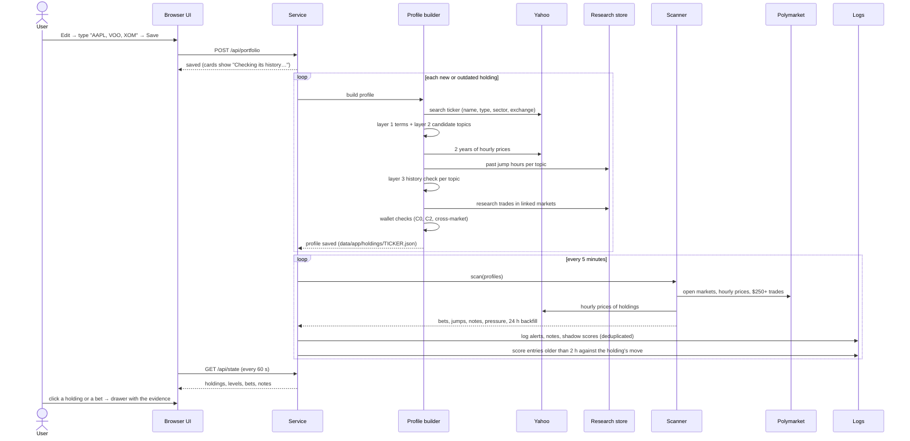
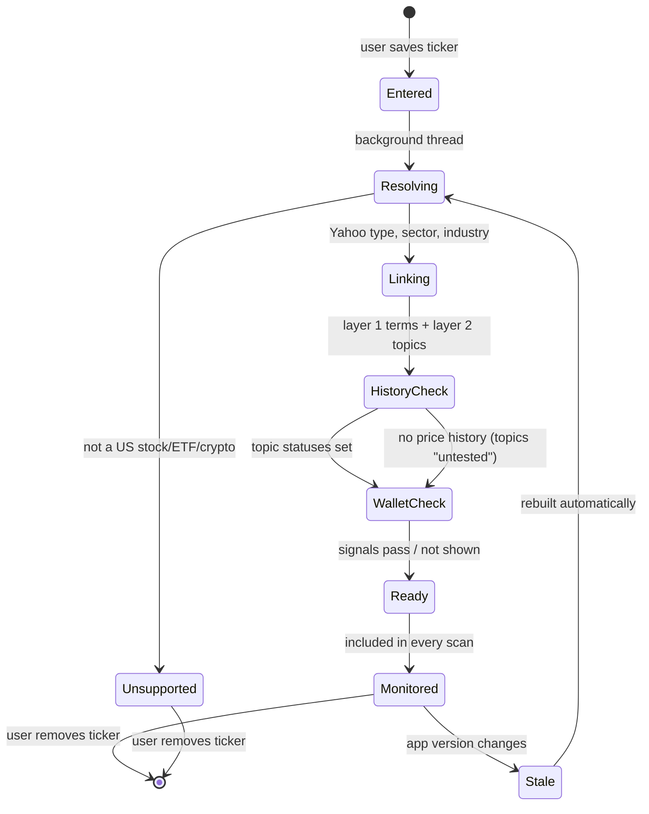
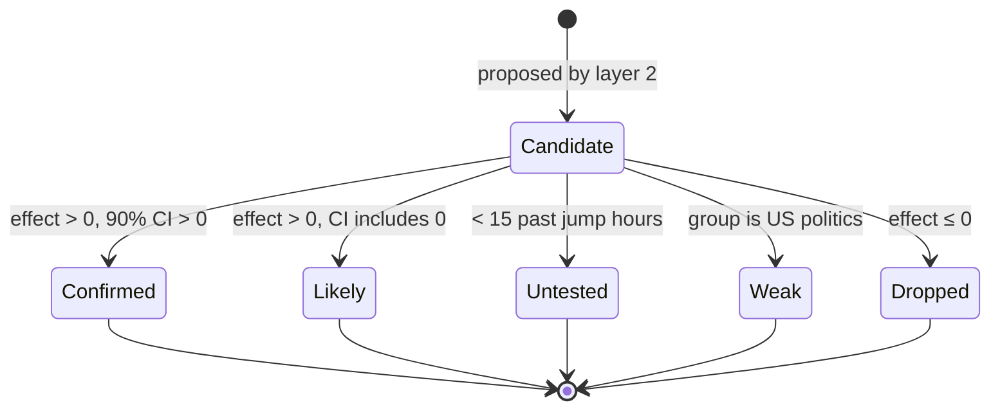
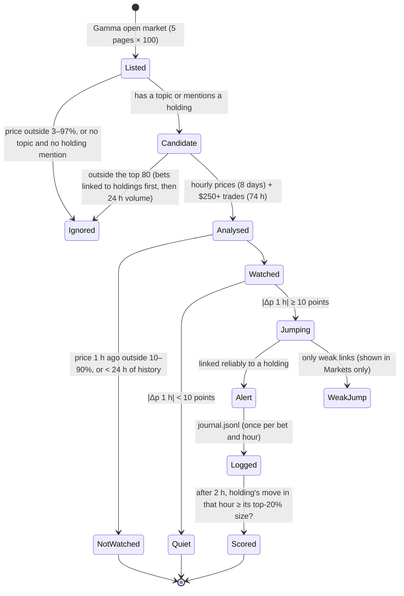
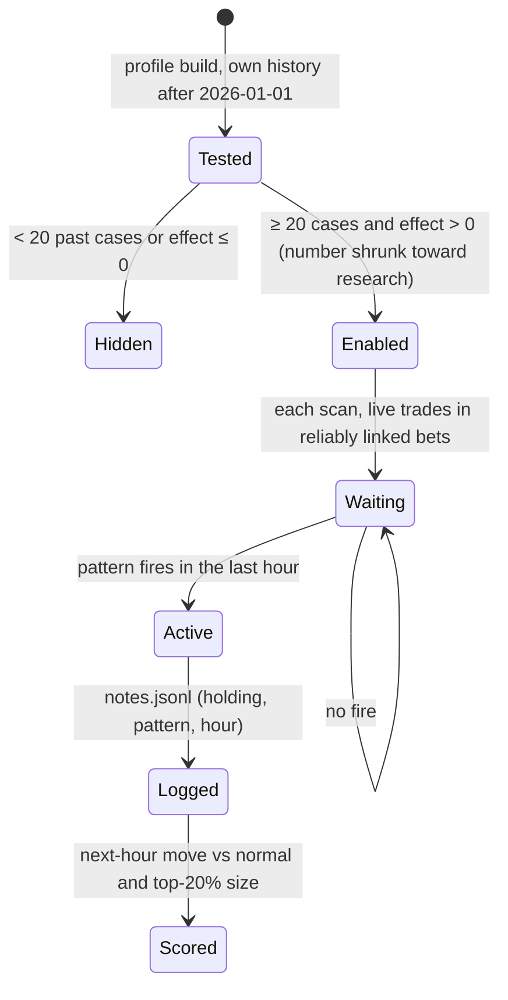

# 08 · EventLens system workflow (living document)

**Current app version: 1.1** (2026-11-27). *Rule: any change to how EventLens links, checks, scans, logs or
shows things updates this file in the same change, and adds a line to the change log at the bottom.*

---

## 1. Actors

| Actor | What it is | Code |
|---|---|---|
| **User** | Person tracking up to 15 US stocks or ETFs (plus BTC/ETH) | – |
| **Browser UI** | Today, Markets, Track record, How we know; refreshes every 60 s | `app/static/` |
| **Server** | Local web server and API at `127.0.0.1:8765` | `app/server.py` |
| **Service** | Holds the portfolio, builds profiles, runs the scan loop every 5 min, writes logs | `monitor/service.py` |
| **Profile builder** | Turns a ticker into checked links (layers 1–3) and wallet checks | `monitor/holdings.py`, `monitor/holding_wallets.py` |
| **Scanner** | One scan: picks bets, reads prices and trades, finds jumps, notes, pressure | `monitor/engine.py` |
| **Yahoo** | Search (name, type, sector) and hourly prices (2 years) | `polymarket/yahoo.py` |
| **Polymarket** | Gamma (open markets), CLOB (hourly prices), Data API ($250+ trades) | `monitor/sources.py` |
| **Research store** | Local research data: past jumps by topic, 2.78M trades, wallet clusters, model | `data/app/`, `data/processed/events/` |
| **Logs** | Alerts, wallet notes, early-warning shadow, each stamped with the version | `data/app/*.jsonl` |

---

## 2. Journey at a glance



---

## 3. Holding lifecycle



- **Unsupported:** not EQUITY, ETF or CRYPTOCURRENCY, or listed outside the US. The card shows the reason.
- **Profile file:** `data/app/holdings/<TICKER>.json`. It is rebuilt only when missing or from an older version.

---

## 4. How a holding's bets are chosen (layers 1–3)

```mermaid
flowchart TD
    T[Ticker] --> RES[Yahoo search: name, type, sector, industry]
    RES --> L1[Layer 1 · direct-mention terms<br/>company name, ticker 3+ letters, executives]
    RES --> L2{Layer 2 · candidate topics}
    L2 -->|ETF in table| ETF[ETF table<br/>VOO, SPY → macro, tariffs/China, rates]
    L2 -->|crypto or crypto stock| CR[crypto]
    L2 -->|industry pattern| IND[industry table<br/>Oil & Gas → oil/Middle East]
    L2 -->|else| SEC[sector table<br/>Financial Services → rates, macro]
    ETF & CR & IND & SEC --> L3
    L3[Layer 3 · history check per candidate topic<br/>holding's next |hourly return| in that topic's past jump hours<br/>vs normal at the same hour of day; day bootstrap, 90% CI]
    L3 --> ST{status}
    ST -->|US politics| WEAK[weak link: shown, never raises level]
    ST -->|< 15 jump hours| UNT[not enough history: kept]
    ST -->|CI above 0| CON[confirmed]
    ST -->|positive, CI includes 0| LIK[likely]
    ST -->|≤ 0| DROP[dropped: not used]
```

**History never adds a topic that layer 2 didn't propose.** That was tried and rejected: jumps cluster in
market-wide busy hours, so almost everything looked linked to crypto.

### Topic link states



A bet is **linked** to a holding if the question mentions a layer-1 term, or its topic (whole-word keywords,
`config.GROUP_KEYWORDS`) is one of the holding's topics other than dropped. The link is **reliable** if it is a
direct mention, or comes through a confirmed, likely or untested topic.

---

## 5. A bet in one scan



For every analysed bet, the scanner also computes:
- the **jumps of the last 24 hours** (backfill),
- **large-wallet pressure**: net YES $ from $5k+ trades in the last hour, if ≥ $500 and the bet is watched,
- the **early-warning score** for the last whole hour and each of the previous 24, logged in shadow only (W8),
- **who traded**: the cluster mix of the last 24 hours.

---

## 6. Holding level on the Today screen

| Level | When |
|---|---|
| **Jumping now** | a reliably linked bet jumped ≥ 10 points in the last hour |
| **Elevated** | a reliably linked bet jumped in the last 24 hours |
| **Calm** | otherwise |

Shown with each holding:
- the 24-hour strip of linked jumps (click the holding for the live price and move charts, section 6c),
- "moves ×N normal in jump hours" (layer-3 average over reliable topics),
- the topic chips with their status,
- any active wallet note.

---

## 6b. Watch the open (D4, v1.2)

The headline feature. Research: an overnight linked jump comes with a bigger first trading hour (+12% vs other
holdings that hour, doc 13; +16% on direct links, doc 14), and 72% of jumps happen while the market is closed.
During trading hours the stock usually moves first (S1), so intraday alerts are worded as explanations.

```mermaid
stateDiagram-v2
    [*] --> Closed: after 16:00 New York, nights, weekends
    Closed --> Opening: 09:30 New York (Mon-Fri)
    Opening --> Open: 2 hours after the open
    Open --> Closed: 16:00 New York
    Closed: list reliable linked jumps since the last close (max 24 h), direct links first
    Opening: keep showing what was flagged for this morning's open
    Open: no overnight list; intraday jumps go to Jumping now, worded "risk is live now"
```

| Step | Rule |
|---|---|
| Window | last US close → now (closed), or last close → today's open (opening); capped at 24 h (the scan keeps 24 h) |
| Jumps counted | reliable links only; crypto bets and round-the-clock assets (BTC-USD) left out, as in the research |
| Direct link | the bet names the holding, or the group is a clean link for it (V4, doc 14): rates→TLT/IEF/SHY, China→FXI/KWEB, oil/Mideast→USO/XLE, Ukraine→ITA/EZU, AI→NVDA/SMH |
| Number shown | +16% if any direct link, else +12%; note "+9% vs +6%" when 2+ jumps |
| Wording | "Expect a livelier open, not a direction: about 3 in 4 alerts still end calm." |
| Limits | exchange holidays not modelled; New York time computed from US daylight-saving rules |

Headline order on Today: jumping now during trading ("Risk is live now…") → jumping while closed → watch the
open (closed, with flagged holdings) → elevated → quiet.

---

## 6c. Holding drawer: live charts (v1.2)

| Panel | What it shows |
|---|---|
| Price | hourly closes, about the last week (8 days); opens on the latest 72 h, drag or scroll sideways to go back; closed stretches squeezed into grey blocks; y axis stays fixed |
| Move ÷ normal | each hour's \|return\| ÷ the holding's normal hour (2-year history from its profile); dashed lines at 1× and at the top-20% size; open bars outlined |
| Across both | linked bet jumps (up / down colour; thick = direct link, dotted = weak link), wallet-pattern markers |

Source: `holding_live()` in `engine.py`, from the latest scan (asset bars: Yahoo 1 month, last 400 kept; each
linked bet's hourly price grid: last 8 days, 10–90% watch band). It updates every scan and keeps the scroll
position; nothing is stored.

---

## 7. Wallet notes (D2, D3)



| Pattern | Fires when (one-hour window) | Research effect |
|---|---|---|
| Market makers surging (C0) | C0's $ flow log ≥ 2 above trailing 48 h mean, ≥ $1k | +9% (W7) |
| Burst traders surging (C2) | same for C2 | +6% (W7) |
| Wallets on several linked bets | wallets trading ≥ 2 linked bets: log count ≥ 1 above trailing mean, ≥ 3 wallets | +21% (W9b) |

---

## 8. Logs and backfill

| File | One row per | Written when | Scored |
|---|---|---|---|
| `journal.jsonl` | bet × hour with a jump | each scan, incl. last 24 h | holding's move in that hour vs its top-20% size |
| `notes.jsonl` | holding × pattern × hour | each scan, incl. last 24 h | holding's next-hour move vs normal |
| `warnings_shadow.jsonl` | watched bet × hour | each scan, incl. last 24 h | later, for W8 |
| `holdings/<T>.json` | holding | profile build | – |

Every row carries `version`. Rows without it are from v1.0. Because each scan backfills 24 hours,
**starting EventLens once a day keeps the record complete**.

---

## 9. Key parameters

| Parameter | Value | Source |
|---|---|---|
| Jump | ≥ 10 points in 1 h | V1, D1–D6 |
| Watched | price 1 h ago 10–90%, ≥ 24 h of history | D1 |
| Bets per scan | 80 (linked first) | D4 |
| Trade filter / large trade | $250+ / $5k+ | research collection, W5 |
| History check | 2 years hourly, ≥ 15 jump hours, 90% CI | 07 |
| Wallet note minimum | ≥ 20 past cases, shrink k = 50 | 07 |
| Scan interval / backfill | 5 min / 24 h | 07 |
| Max holdings | 15 | D1 |

---

## Change log

| Date | Version | Change |
|---|---|---|
| 2026-11-27 | 1.0 | First live version: 26 fixed assets, keyword links, jump alerts, large-wallet pressure, clusters shown descriptively, early warning in shadow mode (D7 fail). |
| 2026-11-27 | 1.1 | `restart.bat` + local-only `POST /api/shutdown` to restart with new code; Track record page tolerates an older server. |
| 2026-11-27 | 1.1 | Portfolio import with layers 1–3 (D1); per-holding wallet notes C0, C2, cross-market (D2, D3); 24 h backfill; version stamps. |
| 2026-11-27 | 1.2 | **Watch the open (D4)**: `watch_open` in the state API, block at the top of Today, direct-link labels from V4; intraday headline reworded to "risk is live now" (explanation, not forecast). |
| 2026-11-27 | 1.2 | **Holding drawer live charts**: price and hourly move ÷ normal over the last 72 trading hours (closed stretches squeezed), linked jumps drawn across both (thick = direct, dotted = weak), open bars outlined, top-20% bars highlighted, wallet-pattern markers; `live` block added to `/api/holding/<sym>`; redraws on every scan. |
| 2026-11-27 | 1.2.1 | Fix: profiles whose wallet check failed are rebuilt on the next start (the check failed after the move to `FYP/alertSystem` because `data/processed/events` was missing; now copied). Drawer says "waiting for the next scan" for a holding not scanned yet. Fix: clicking a bet opened the last holding instead of the bet (1.2 drawer-refresh bug). |
| 2026-11-27 | 1.2.2 | Holding chart: drag / scroll back about a week (bets' hourly grid 72 h → 8 days, Yahoo bars 5 d → 1 mo); fixed y axis; fix: the first bar in the window (often an open) was missing. Market drawer still shows 72 h. |
