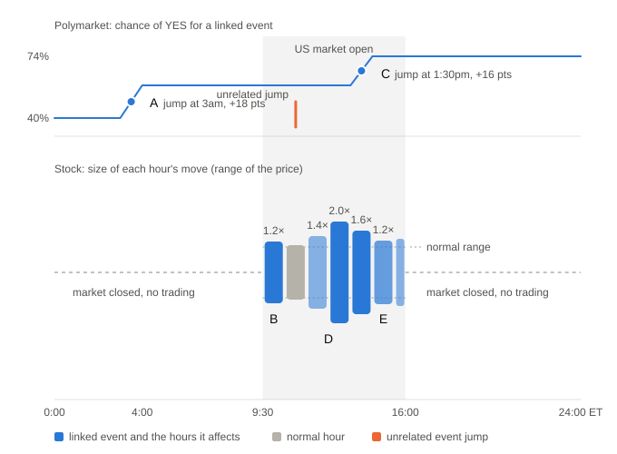

# 11 · How an event jump relates to a stock's movement: one illustrative day

*Made-up data for one day of SPY (US Eastern time). The shape and multipliers are the measured averages from
the research (S1 and S2 in `docs/09_sequence_test.md`; V2 charts in `docs/10_v2_charts.md`). A real day varies more.*

Each bar is the range the stock moves in that hour. 1.0× is the normal range for that time of day (dotted lines).
The US market is closed outside 9:30–16:00 ET (the shaded band is when it is open).

- **A, overnight jump.** At 3am a linked Polymarket event jumps (+18 points). The stock can't trade yet.
- **B, bigger open.** The first hour after the open is wider than a normal open: measured about 1.16× (drawn
  as 1.2×). Here the event comes first and the stock follows (S2).
- **Unrelated jump (orange).** An event not linked to this stock jumps and the stock stays normal. This is why
  the research compares against unrelated jumps: busy news alone does not widen this stock's range.
- **D, stock moves first.** Before the 1:30pm jump (C) the stock is already moving, peaking about 2.0× in the
  hour before. During trading hours, news reaches stocks faster than Polymarket (S1).
- **E, risk stays up.** After the jump the range stays wider for 2–3 hours (about 1.2–1.3×), then returns to normal.

**What this means for the product:** before the open, EventLens warns (A → B). During trading hours it explains
why the stock is moving and how long the risk may last (D → E). It never says which direction.

## Real days in the same layout (`results/20261127-1600_v2_charts/real_days/`)

Script: `scripts/v2_real_days.py`. Days were picked automatically: a linked bet jumped overnight *and* again during
the session, ranked by how big the open and the moves around the intraday jump were. Top four:

| Chart | Holding | Day | Open | Max near intraday jump | Linked bets that jumped |
|---|---|---|---|---|---|
| R1 | SPY | Thu 10 Apr 2025 | 5.6× | 10.8× | Canada tariffs; US–China trade deal |
| R2 | USO | Fri 13 Jun 2025 | 4.3× | 4.1× | Israel/US military action against Iran |
| R3 | GLD | Fri 30 Jan 2026 | 14.6× | 24.7× | Trump–Putin call; Iran strike on Israel |
| R4 | KWEB | Mon 10 Mar 2025 | 3.1× | 3.9× | Tariffs on Mexico and Canada |

**These are hand-picked best cases.** Of all 257 days with both an overnight and an intraday linked jump, 53% opened
bigger than normal and 46% had a move over 1.5× near the intraday jump. Some of the best examples (R1, R3) are
market-wide shock days where everything moved, so the bets are part of the story, not all of it. R2 (Israel strikes
Iran overnight → oil opens 4.3× normal) is the cleanest example of the A → B pattern.

### How many real days look like the diagram (`real_days/pattern_counts.csv`, `real_days/gallery/`)

"Looks like the diagram" means the first hour opened bigger than normal **and** some hour near the intraday
jump moved more than 1.5× normal.

| Days | Count | Open bigger than normal | > 1.5× near intraday jump | Both (looks like the diagram) |
|---|---|---|---|---|
| Linked jump overnight **and** during the session | 257 | 53% | 46% | **28% (72 days)** |
| No linked jump at all (comparison) | 7,086 | 45% | 42% | 21.6% (1,533 days) |

**72 real days match.** The 40 strongest are drawn in `real_days/gallery/` (G001…G040), and all 72 are listed in
`gallery/matching_days.csv`. The four reference charts (R1–R4) are the top of that list.

The honest comparison: days with linked jumps look like this **about 1.3× as often** as days without (28% vs
21.6%). That is a real tilt, not a rule: most linked-jump days do *not* look like the diagram, and some
no-jump days do.
