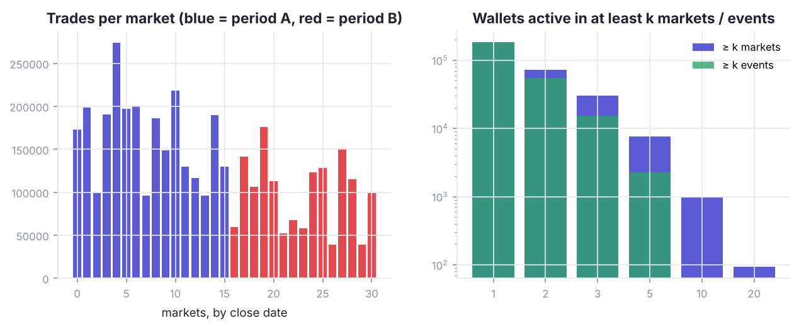

## E0 · Dataset overview

**Question.** What does the data cover, and do enough wallets trade many markets to measure skill?

**Verdict: DESCRIPTIVE.** 31 markets in 7 events, 4,109,747 trades by 255,931 wallets; 7,612 wallets traded 5+ markets and the top 1% of wallets did 74% of the volume.

| metric | value |
|---|---|
| markets | 31 |
| events | 7 |
| trades | 4109747 |
| wallets | 255931 |
| first_close | 2025-12-10 |
| last_close | 2026-09-16 |
| split_date | 2026-06-17 |
| period_a_markets | 16 |
| period_b_markets | 15 |
| top_1pct_wallets_share_of_volume | 0.7403 |
| wallets_with_5plus_markets | 7612 |
| wallets_with_3plus_events | 15496 |
| yes_resolution_rate | 0.2258 |

Tables: [markets](tables/markets.csv), [wallet_repeat](tables/wallet_repeat.csv)

- Trade rows are participant records: each fill appears once for every wallet in it.
- Dataset source: fyp_fed_exports
