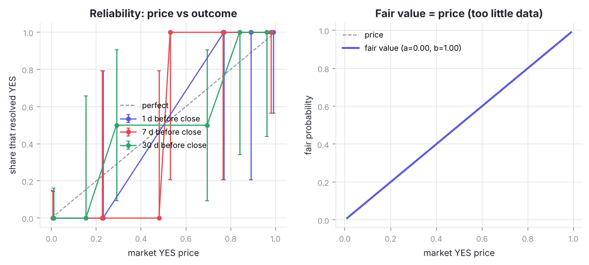

## E1 · Calibration and fair value (H0)

**Question.** Do YES prices match how often YES happens, and can a simple recalibration improve them?

**Verdict: DESCRIPTIVE.** Only 48 period-A calibration points (< 100): fair value is the market price itself. Average bucket gap 4.5%.

| metric | value |
|---|---|
| points | 93 |
| markets | 31 |
| mean_abs_gap | 0.04504 |
| brier_by_horizon.1d | 0.004131 |
| brier_by_horizon.7d | 0.01821 |
| brier_by_horizon.30d | 0.04088 |
| fair_value.a | 0 |
| fair_value.b | 1 |
| fair_value.n | 48 |
| fair_value.fitted | False |
| period_b_logloss_market | 0.1239 |
| period_b_logloss_fair | 0.1239 |
| period_b_logloss_improvement | 0 |

Tables: [brier](tables/brier.csv), [reliability](tables/reliability.csv)

- Fair value is fitted on period A only and used for every edge measure in E2–E4.
- Points from different horizons of the same market are not independent.
