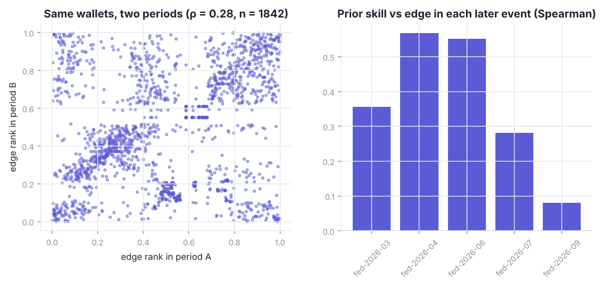

## E2 · Skill persistence (H1)

**Question.** Do wallets with high edge in earlier markets also have high edge in later markets?

**Verdict: PASS.** Spearman ρ between period-A and period-B edge = 0.276 (95% CI 0.225 to 0.325, permutation p = 0.0010, 1842 wallets with ≥ 3 markets in each period). Holding long-shot style fixed: ρ = 0.009.

| metric | value |
|---|---|
| edge_vs_fair.rho | 0.2757 |
| edge_vs_fair.p_one_sided | 0.000999 |
| edge_vs_fair.low | 0.2249 |
| edge_vs_fair.high | 0.3255 |
| edge_vs_fair.n | 1842 |
| edge_vs_price.rho | 0.2757 |
| edge_vs_price.p_one_sided | 0.000999 |
| edge_vs_price.low | 0.2249 |
| edge_vs_price.high | 0.3255 |
| edge_vs_price.n | 1842 |
| partial_longshot.rho | 0.009389 |
| partial_longshot.n | 1842 |
| rolling_mean_rho | 0.3676 |
| rolling_events | 5 |
| min_markets_per_period | 3 |

Tables: [rolling](tables/rolling.csv), [wallet_pairs](tables/wallet_pairs.csv)

- Pass rule (pre-registered): ρ > 0 with permutation p < 0.05; fewer than 30 wallets = inconclusive.
- Edge is measured against fair value from E1; the raw-price version is reported for comparison.
