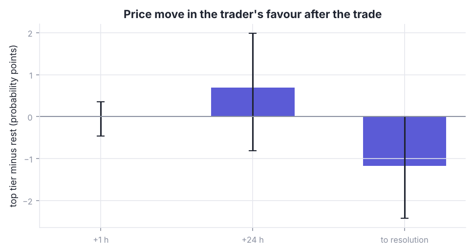

## E3 · Information in skilled wallets' trades (H2)

**Question.** Is the price more likely to move in a trade's direction when the trader has proven skill?

**Verdict: INCONCLUSIVE.** Top-tier trades beat other trades by -1.17 points to resolution (95% CI -2.43 to -0.00; 12 markets, 3 events).

| metric | value |
|---|---|
| main.sample | band |
| main.weighting | equal |
| main.horizon | markout_res |
| main.top_mean | -0.006867 |
| main.rest_mean | 0.004848 |
| main.diff | -0.01171 |
| main.low | -0.02426 |
| main.high | -8.728e-06 |
| main.p | 0.0285 |
| main.markets | 12 |
| main.events | 3 |
| top_tier_share_of_trades | 0.04371 |
| period_b_trades | 1467264 |
| banded_trades | 536467 |

Tables: [markout_tests](tables/markout_tests.csv), [per_market_main](tables/per_market_main.csv), [tier_means_pct_points](tables/tier_means_pct_points.csv)

- Skill tier is decided with markets closed before each trade (walk-forward).
- Main test (pre-registered): trades with YES price in the band, equal weight, to resolution; per-market differences, bootstrap over events. Fewer than 5 events or 10 markets = inconclusive.
