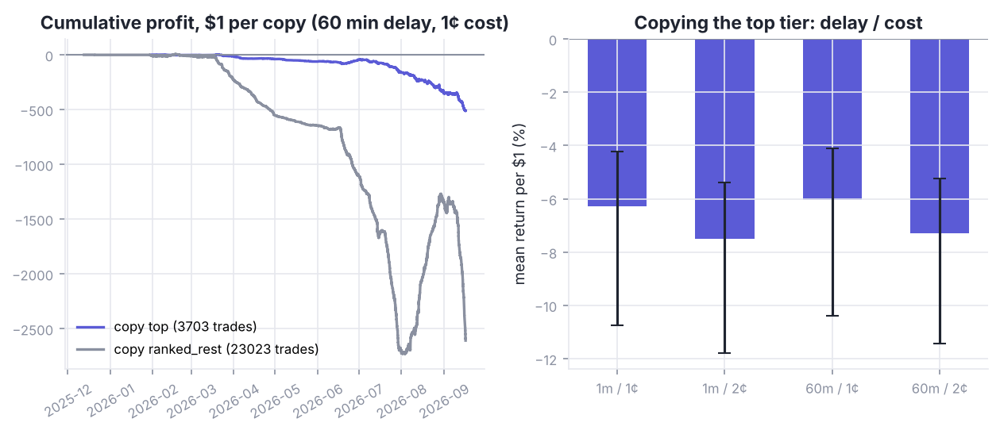

## E4 · Copy-trading backtest (H3)

**Question.** After realistic delay and costs, does following skilled wallets make money?

**Verdict: INCONCLUSIVE.** Copying top-tier wallets 60 min later with a 1¢ cost returns -6.0% per $1 (95% CI -10.4% to -4.1%; 3703 copies in 10 markets) vs -11.4% for other ranked wallets.

| metric | value |
|---|---|
| main.tier | top |
| main.delay_s | 3600 |
| main.cost | 0.01 |
| main.signals | 3778 |
| main.copies | 3703 |
| main.markets | 10 |
| main.events | 3 |
| main.mean_return | -0.06044 |
| main.low | -0.104 |
| main.high | -0.04097 |
| main.hit_rate | 0.5639 |
| main.mean_entry_price | 0.6045 |
| baseline_rest.tier | ranked_rest |
| baseline_rest.delay_s | 3600 |
| baseline_rest.cost | 0.01 |
| baseline_rest.signals | 23457 |
| baseline_rest.copies | 23023 |
| baseline_rest.markets | 11 |
| baseline_rest.events | 3 |
| baseline_rest.mean_return | -0.1138 |
| baseline_rest.low | -0.1925 |
| baseline_rest.high | 0.01539 |
| baseline_rest.hit_rate | 0.5503 |
| baseline_rest.mean_entry_price | 0.553 |

Tables: [backtest_grid](tables/backtest_grid.csv)

- Signals: top-tier trades of at least $100 with YES price in (0.05, 0.95), one per wallet/market/hour; entry at the last price after the delay plus the cost; held to resolution.
- Pass rule (pre-registered): 60-minute delay, 1¢ cost, mean > 0 with CI above 0.
