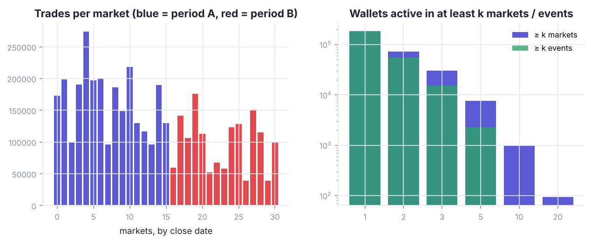
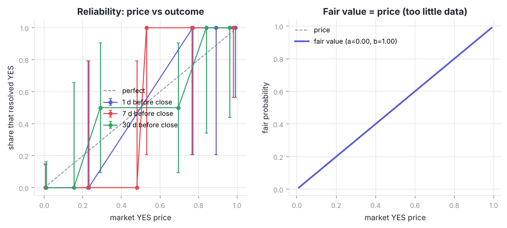
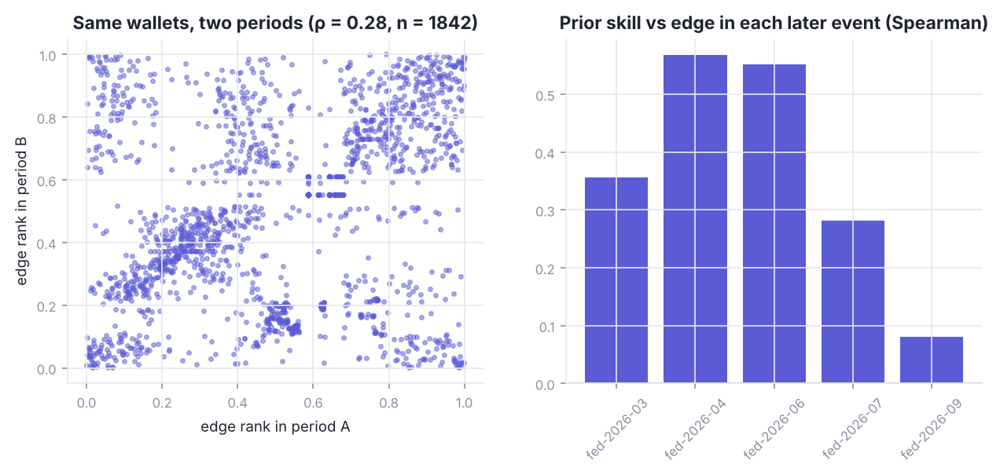
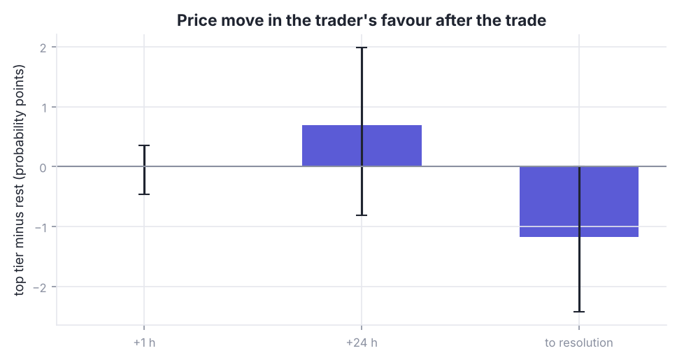
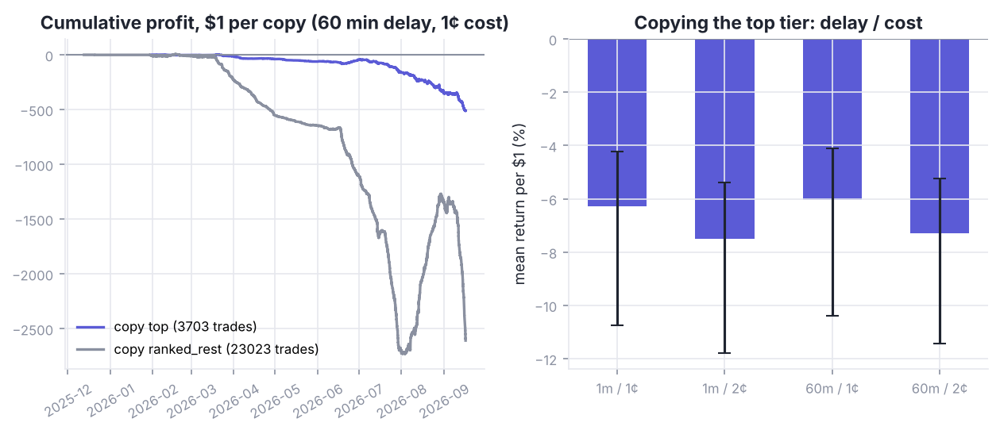

# F · Smart money inside Polymarket

Run `20261126-164625_polymarket_pilot_fed` on dataset **pilot_fed**.

| Experiment | Verdict | Headline |
|---|---|---|
| [E0 Dataset overview](e0/summary.md) | **descriptive** | 31 markets in 7 events, 4,109,747 trades by 255,931 wallets; 7,612 wallets traded 5+ markets and the top 1% of wallets did 74% of the volume. |
| [E1 Calibration and fair value (H0)](e1/summary.md) | **descriptive** | Only 48 period-A calibration points (< 100): fair value is the market price itself. Average bucket gap 4.5%. |
| [E2 Skill persistence (H1)](e2/summary.md) | **pass** | Spearman ρ between period-A and period-B edge = 0.276 (95% CI 0.225 to 0.325, permutation p = 0.0010, 1842 wallets with ≥ 3 markets in each period). Holding long-shot style fixed: ρ = 0.009. |
| [E3 Information in skilled wallets' trades (H2)](e3/summary.md) | **inconclusive** | Top-tier trades beat other trades by -1.17 points to resolution (95% CI -2.43 to -0.00; 12 markets, 3 events). |
| [E4 Copy-trading backtest (H3)](e4/summary.md) | **inconclusive** | Copying top-tier wallets 60 min later with a 1¢ cost returns -6.0% per $1 (95% CI -10.4% to -4.1%; 3703 copies in 10 markets) vs -11.4% for other ranked wallets. |
| [E5 App export](e5/summary.md) | **descriptive** | Exported 2000 wallet track records (3012 in the top tier) and 31 market pages. Out of sample, the top tier's net side won in 100% of 15 markets (the market's own mid-life favourite: 87%). |

**Decision (pre-registered rule):** Inconclusive: not enough independent events for at least one test. Collect the wider universe before deciding.

## E0 · Dataset overview

**Question.** What does the data cover, and do enough wallets trade many markets to measure skill?

**Verdict: DESCRIPTIVE.** 31 markets in 7 events, 4,109,747 trades by 255,931 wallets; 7,612 wallets traded 5+ markets and the top 1% of wallets did 74% of the volume.

| metric | value |
|---|---|
| markets | 31 |
| events | 7 |
| trades | 4109747 |
| wallets | 255931 |
| first_close | 2025-12-10 |
| last_close | 2026-09-16 |
| split_date | 2026-06-17 |
| period_a_markets | 16 |
| period_b_markets | 15 |
| top_1pct_wallets_share_of_volume | 0.7403 |
| wallets_with_5plus_markets | 7612 |
| wallets_with_3plus_events | 15496 |
| yes_resolution_rate | 0.2258 |

Tables: [markets](e0/tables/markets.csv), [wallet_repeat](e0/tables/wallet_repeat.csv)

- Trade rows are participant records: each fill appears once for every wallet in it.
- Dataset source: fyp_fed_exports

## E1 · Calibration and fair value (H0)

**Question.** Do YES prices match how often YES happens, and can a simple recalibration improve them?

**Verdict: DESCRIPTIVE.** Only 48 period-A calibration points (< 100): fair value is the market price itself. Average bucket gap 4.5%.

| metric | value |
|---|---|
| points | 93 |
| markets | 31 |
| mean_abs_gap | 0.04504 |
| brier_by_horizon.1d | 0.004131 |
| brier_by_horizon.7d | 0.01821 |
| brier_by_horizon.30d | 0.04088 |
| fair_value.a | 0 |
| fair_value.b | 1 |
| fair_value.n | 48 |
| fair_value.fitted | False |
| period_b_logloss_market | 0.1239 |
| period_b_logloss_fair | 0.1239 |
| period_b_logloss_improvement | 0 |

Tables: [brier](e1/tables/brier.csv), [reliability](e1/tables/reliability.csv)

- Fair value is fitted on period A only and used for every edge measure in E2–E4.
- Points from different horizons of the same market are not independent.

## E2 · Skill persistence (H1)

**Question.** Do wallets with high edge in earlier markets also have high edge in later markets?

**Verdict: PASS.** Spearman ρ between period-A and period-B edge = 0.276 (95% CI 0.225 to 0.325, permutation p = 0.0010, 1842 wallets with ≥ 3 markets in each period). Holding long-shot style fixed: ρ = 0.009.

| metric | value |
|---|---|
| edge_vs_fair.rho | 0.2757 |
| edge_vs_fair.p_one_sided | 0.000999 |
| edge_vs_fair.low | 0.2249 |
| edge_vs_fair.high | 0.3255 |
| edge_vs_fair.n | 1842 |
| edge_vs_price.rho | 0.2757 |
| edge_vs_price.p_one_sided | 0.000999 |
| edge_vs_price.low | 0.2249 |
| edge_vs_price.high | 0.3255 |
| edge_vs_price.n | 1842 |
| partial_longshot.rho | 0.009389 |
| partial_longshot.n | 1842 |
| rolling_mean_rho | 0.3676 |
| rolling_events | 5 |
| min_markets_per_period | 3 |

Tables: [rolling](e2/tables/rolling.csv), [wallet_pairs](e2/tables/wallet_pairs.csv)

- Pass rule (pre-registered): ρ > 0 with permutation p < 0.05; fewer than 30 wallets = inconclusive.
- Edge is measured against fair value from E1; the raw-price version is reported for comparison.

## E3 · Information in skilled wallets' trades (H2)

**Question.** Is the price more likely to move in a trade's direction when the trader has proven skill?

**Verdict: INCONCLUSIVE.** Top-tier trades beat other trades by -1.17 points to resolution (95% CI -2.43 to -0.00; 12 markets, 3 events).

| metric | value |
|---|---|
| main.sample | band |
| main.weighting | equal |
| main.horizon | markout_res |
| main.top_mean | -0.006867 |
| main.rest_mean | 0.004848 |
| main.diff | -0.01171 |
| main.low | -0.02426 |
| main.high | -8.728e-06 |
| main.p | 0.0285 |
| main.markets | 12 |
| main.events | 3 |
| top_tier_share_of_trades | 0.04371 |
| period_b_trades | 1467264 |
| banded_trades | 536467 |

Tables: [markout_tests](e3/tables/markout_tests.csv), [per_market_main](e3/tables/per_market_main.csv), [tier_means_pct_points](e3/tables/tier_means_pct_points.csv)

- Skill tier is decided with markets closed before each trade (walk-forward).
- Main test (pre-registered): trades with YES price in the band, equal weight, to resolution; per-market differences, bootstrap over events. Fewer than 5 events or 10 markets = inconclusive.

## E4 · Copy-trading backtest (H3)

**Question.** After realistic delay and costs, does following skilled wallets make money?

**Verdict: INCONCLUSIVE.** Copying top-tier wallets 60 min later with a 1¢ cost returns -6.0% per $1 (95% CI -10.4% to -4.1%; 3703 copies in 10 markets) vs -11.4% for other ranked wallets.

| metric | value |
|---|---|
| main.tier | top |
| main.delay_s | 3600 |
| main.cost | 0.01 |
| main.signals | 3778 |
| main.copies | 3703 |
| main.markets | 10 |
| main.events | 3 |
| main.mean_return | -0.06044 |
| main.low | -0.104 |
| main.high | -0.04097 |
| main.hit_rate | 0.5639 |
| main.mean_entry_price | 0.6045 |
| baseline_rest.tier | ranked_rest |
| baseline_rest.delay_s | 3600 |
| baseline_rest.cost | 0.01 |
| baseline_rest.signals | 23457 |
| baseline_rest.copies | 23023 |
| baseline_rest.markets | 11 |
| baseline_rest.events | 3 |
| baseline_rest.mean_return | -0.1138 |
| baseline_rest.low | -0.1925 |
| baseline_rest.high | 0.01539 |
| baseline_rest.hit_rate | 0.5503 |
| baseline_rest.mean_entry_price | 0.553 |

Tables: [backtest_grid](e4/tables/backtest_grid.csv)

- Signals: top-tier trades of at least $100 with YES price in (0.05, 0.95), one per wallet/market/hour; entry at the last price after the delay plus the cost; held to resolution.
- Pass rule (pre-registered): 60-minute delay, 1¢ cost, mean > 0 with CI above 0.

## E5 · App export

**Question.** What does the trading helper load?

**Verdict: DESCRIPTIVE.** Exported 2000 wallet track records (3012 in the top tier) and 31 market pages. Out of sample, the top tier's net side won in 100% of 15 markets (the market's own mid-life favourite: 87%).

| metric | value |
|---|---|
| ranked_wallets | 30041 |
| top_wallets | 3012 |
| top_threshold | 0.0165 |
| exported_wallets | 2000 |
| markets | 31 |
| out_of_sample_markets_with_top_flow | 15 |
| top_net_side_hit_rate | 1 |
| market_favourite_hit_rate | 0.8667 |
| fair_value.a | 0 |
| fair_value.b | 1 |
| fair_value.n | 48 |
| fair_value.fitted | False |

Tables: [market_index](e5/tables/market_index.csv), [wallet_recent_markets](e5/tables/wallet_recent_markets.csv), [wallet_scores](e5/tables/wallet_scores.csv)

- Wallet scores use every resolved market (the app looks forward from today), so historical market pages contain hindsight; the out-of-sample hit rate uses point-in-time tiers only.
