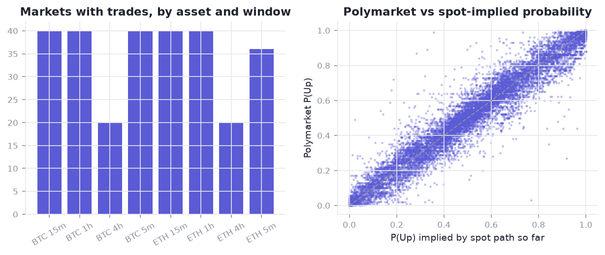

## C0 · G0 · Data and alignment

**Question.** Do we have enough crypto markets, and do their windows line up with the spot candles?

**Verdict: FAIL.** 276 markets with trades, 13,795 asset-minutes over 79 days; resolution matches the spot candle in 93.8% of markets.

| metric | value |
|---|---|
| markets_sampled | 276 |
| markets_with_trades | 276 |
| trades | 184056 |
| wallets | 10464 |
| panel_minutes | 13795 |
| panel_days | 79 |
| outcome_vs_spot_agreement | 0.9384 |
| window_shifts_s.BTC-15m | 0 |
| window_shifts_s.BTC-1h | 0 |
| window_shifts_s.BTC-4h | 0 |
| window_shifts_s.BTC-5m | 0 |
| window_shifts_s.ETH-15m | 0 |
| window_shifts_s.ETH-1h | 0 |
| window_shifts_s.ETH-4h | 0 |
| window_shifts_s.ETH-5m | -60 |
| corr_p_q | 0.9721 |

Tables: [alignment](tables/alignment.csv), [by_kind](tables/by_kind.csv), [coverage](tables/coverage.csv)

- Pass rule: ≥ 500 markets with trades and ≥ 95% agreement between the resolution and spot(close) ≥ spot(open) over the market window.
- A window shift is applied only if it beats the documented window by 5+ points of agreement.
