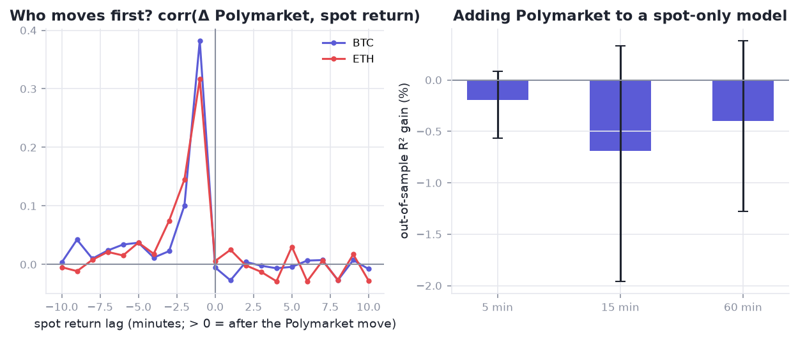

## C1 · G1 · Does Polymarket lead spot?

**Question.** Beyond what the spot path already says, does the Polymarket price predict the next spot return?

**Verdict: FAIL.** At 5 min, adding Polymarket's view changes out-of-sample R² by -0.196% (95% CI -0.564% to +0.083%, 69 test days); daily rank correlation +0.008.

| metric | value |
|---|---|
| main.gain | -0.001957 |
| main.low | -0.005641 |
| main.high | 0.0008287 |
| main.days | 69 |
| main.rows | 11902 |
| main.r2_model | -0.005171 |
| main.r2_baseline | -0.003208 |
| main.p_gain_le_0 | 0.9175 |
| ic_main.ic | 0.008166 |
| ic_main.low | -0.02841 |
| ic_main.high | 0.04325 |
| ic_main.days | 74 |
| coefficients_full_sample.intercept | -4.958e-06 |
| coefficients_full_sample.r_past | -0.02143 |
| coefficients_full_sample.u | -7.245e-05 |
| peak_lead_lag.asset | BTC |
| peak_lead_lag.lag_min | -1 |
| peak_lead_lag.corr | 0.3823 |

Tables: [by_horizon](tables/by_horizon.csv), [lead_lag](tables/lead_lag.csv)

- Signal u = logit(Polymarket P(Up)) − logit(P(Up) implied by the spot path and recent volatility).
- Walk-forward by day (≥ 10 training days); CI by resampling test days.
- Pass rule: R² gain > 0 with the 95% CI above 0 at the main horizon; < 20 test days = inconclusive.
