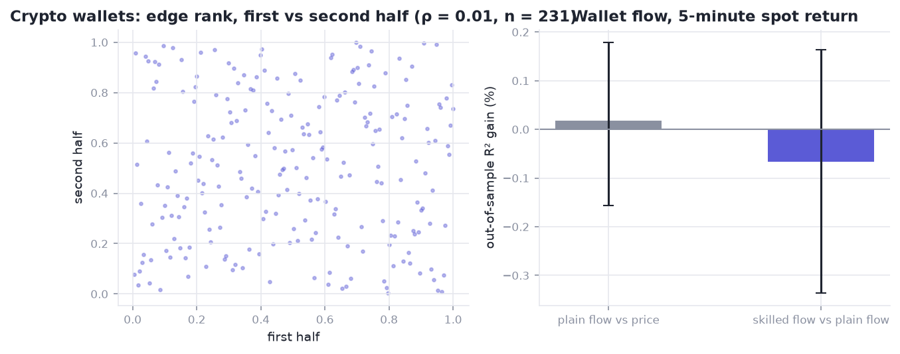

## C2 · G2 · Do skilled wallets lead?

**Question.** Does net buying by wallets with a proven record (judged only on earlier markets) predict spot?

**Verdict: FAIL.** Skilled-wallet flow changes out-of-sample R² by -0.067% beyond plain flow (95% CI -0.336% to +0.164%); crypto wallet edge persistence ρ = 0.01 (231 wallets).

| metric | value |
|---|---|
| skill_over_flow.gain | -0.0006702 |
| skill_over_flow.low | -0.003359 |
| skill_over_flow.high | 0.001642 |
| skill_over_flow.days | 69 |
| skill_over_flow.rows | 11902 |
| skill_over_flow.r2_model | -0.005662 |
| skill_over_flow.r2_baseline | -0.004988 |
| skill_over_flow.p_gain_le_0 | 0.7055 |
| flow_over_price.gain | 0.0001823 |
| flow_over_price.low | -0.001564 |
| flow_over_price.high | 0.00179 |
| flow_over_price.days | 69 |
| flow_over_price.rows | 11902 |
| flow_over_price.r2_model | -0.004988 |
| flow_over_price.r2_baseline | -0.005171 |
| flow_over_price.p_gain_le_0 | 0.3995 |
| ic_top_flow.ic | -0.08268 |
| ic_top_flow.low | -0.1584 |
| ic_top_flow.high | -0.007892 |
| ic_top_flow.days | 69 |
| persistence_rho | 0.01384 |
| persistence_wallets | 231 |

Tables: [wallet_pairs](tables/wallet_pairs.csv)

- Top tier = top 10% of shrunk edge among wallets with ≥ 5 resolved crypto markets before the trade.
- Pass rule: skilled flow's R² gain over plain flow > 0 with the 95% CI above 0.
