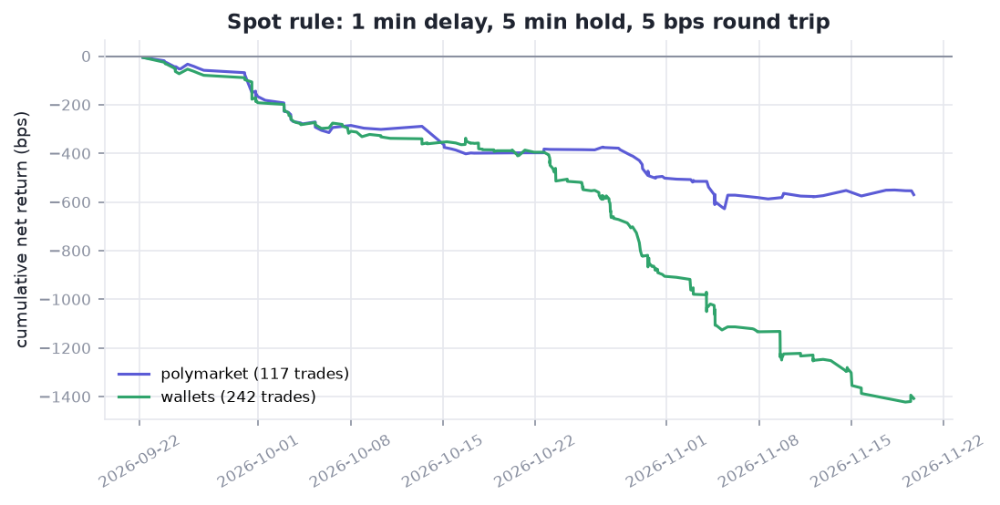

## C3 · G3 · Tradable after costs?

**Question.** Trading spot when the model's signal is strong, entering one minute late and paying fees: is it profitable?

**Verdict: FAIL.** Best rule (polymarket) nets -4.87 bps per trade at 5 bps cost (95% CI -7.44 to -2.19, 117 trades).

| metric | value |
|---|---|
| main.signal | edge_polymarket |
| main.cost_bps | 5 |
| main.trades | 117 |
| main.days | 46 |
| main.mean_bps | -4.872 |
| main.low | -7.44 |
| main.high | -2.19 |
| main.hit_rate | 0.265 |
| main.gross_bps | 0.128 |
| best.signal | edge_polymarket |
| best.cost_bps | 5 |
| best.trades | 117 |
| best.days | 46 |
| best.mean_bps | -4.872 |
| best.low | -7.44 |
| best.high | -2.19 |
| best.hit_rate | 0.265 |
| best.gross_bps | 0.128 |

Tables: [rules](tables/rules.csv)

- Threshold: top 10% of |signal| on earlier days only; one open position per asset.
- Pass rule: any rule with mean net return > 0 and CI above 0 at 5 bps; 20 bps (retail taker fees) is reported too. < 100 trades = inconclusive.
