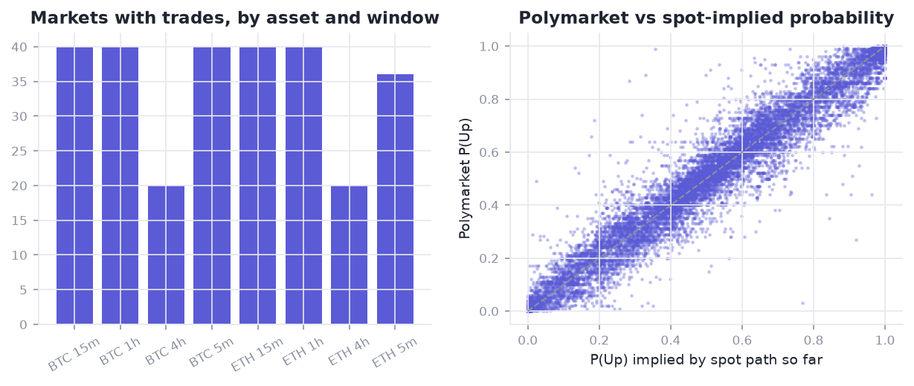
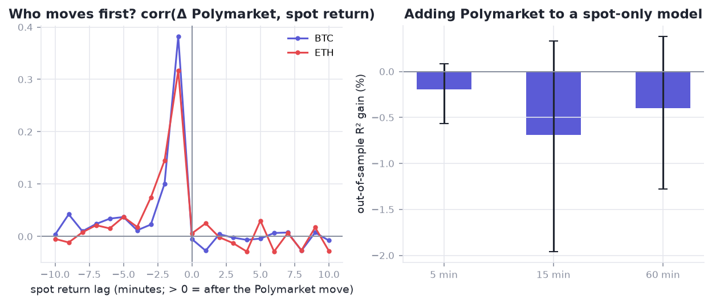
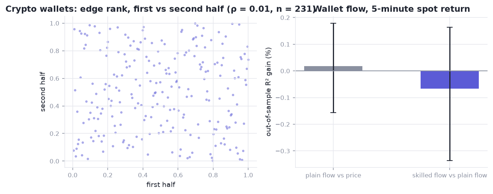
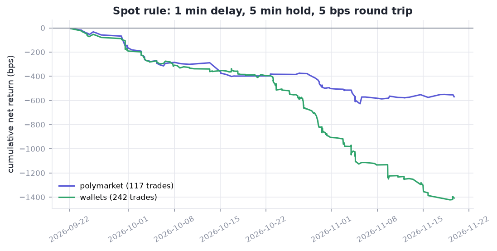

# T1 · Polymarket crypto markets as a lead signal for BTC/ETH

Run `20261126-174329_crypto` on dataset **crypto**.

| Experiment | Verdict | Headline |
|---|---|---|
| [C0 G0 · Data and alignment](c0/summary.md) | **fail** | 276 markets with trades, 13,795 asset-minutes over 79 days; resolution matches the spot candle in 93.8% of markets. |
| [C1 G1 · Does Polymarket lead spot?](c1/summary.md) | **fail** | At 5 min, adding Polymarket's view changes out-of-sample R² by -0.196% (95% CI -0.564% to +0.083%, 69 test days); daily rank correlation +0.008. |
| [C2 G2 · Do skilled wallets lead?](c2/summary.md) | **fail** | Skilled-wallet flow changes out-of-sample R² by -0.067% beyond plain flow (95% CI -0.336% to +0.164%); crypto wallet edge persistence ρ = 0.01 (231 wallets). |
| [C3 G3 · Tradable after costs?](c3/summary.md) | **fail** | Best rule (polymarket) nets -4.87 bps per trade at 5 bps cost (95% CI -7.44 to -2.19, 117 trades). |

**Decision (pre-registered rule):** G0 failed: not enough aligned data to test T1. Fix the data (see C0) before judging the topic.

## C0 · G0 · Data and alignment

**Question.** Do we have enough crypto markets, and do their windows line up with the spot candles?

**Verdict: FAIL.** 276 markets with trades, 13,795 asset-minutes over 79 days; resolution matches the spot candle in 93.8% of markets.

| metric | value |
|---|---|
| markets_sampled | 276 |
| markets_with_trades | 276 |
| trades | 184056 |
| wallets | 10464 |
| panel_minutes | 13795 |
| panel_days | 79 |
| outcome_vs_spot_agreement | 0.9384 |
| window_shifts_s.BTC-15m | 0 |
| window_shifts_s.BTC-1h | 0 |
| window_shifts_s.BTC-4h | 0 |
| window_shifts_s.BTC-5m | 0 |
| window_shifts_s.ETH-15m | 0 |
| window_shifts_s.ETH-1h | 0 |
| window_shifts_s.ETH-4h | 0 |
| window_shifts_s.ETH-5m | -60 |
| corr_p_q | 0.9721 |

Tables: [alignment](c0/tables/alignment.csv), [by_kind](c0/tables/by_kind.csv), [coverage](c0/tables/coverage.csv)

- Pass rule: ≥ 500 markets with trades and ≥ 95% agreement between the resolution and spot(close) ≥ spot(open) over the market window.
- A window shift is applied only if it beats the documented window by 5+ points of agreement.

## C1 · G1 · Does Polymarket lead spot?

**Question.** Beyond what the spot path already says, does the Polymarket price predict the next spot return?

**Verdict: FAIL.** At 5 min, adding Polymarket's view changes out-of-sample R² by -0.196% (95% CI -0.564% to +0.083%, 69 test days); daily rank correlation +0.008.

| metric | value |
|---|---|
| main.gain | -0.001957 |
| main.low | -0.005641 |
| main.high | 0.0008287 |
| main.days | 69 |
| main.rows | 11902 |
| main.r2_model | -0.005171 |
| main.r2_baseline | -0.003208 |
| main.p_gain_le_0 | 0.9175 |
| ic_main.ic | 0.008166 |
| ic_main.low | -0.02841 |
| ic_main.high | 0.04325 |
| ic_main.days | 74 |
| coefficients_full_sample.intercept | -4.958e-06 |
| coefficients_full_sample.r_past | -0.02143 |
| coefficients_full_sample.u | -7.245e-05 |
| peak_lead_lag.asset | BTC |
| peak_lead_lag.lag_min | -1 |
| peak_lead_lag.corr | 0.3823 |

Tables: [by_horizon](c1/tables/by_horizon.csv), [lead_lag](c1/tables/lead_lag.csv)

- Signal u = logit(Polymarket P(Up)) − logit(P(Up) implied by the spot path and recent volatility).
- Walk-forward by day (≥ 10 training days); CI by resampling test days.
- Pass rule: R² gain > 0 with the 95% CI above 0 at the main horizon; < 20 test days = inconclusive.

## C2 · G2 · Do skilled wallets lead?

**Question.** Does net buying by wallets with a proven record (judged only on earlier markets) predict spot?

**Verdict: FAIL.** Skilled-wallet flow changes out-of-sample R² by -0.067% beyond plain flow (95% CI -0.336% to +0.164%); crypto wallet edge persistence ρ = 0.01 (231 wallets).

| metric | value |
|---|---|
| skill_over_flow.gain | -0.0006702 |
| skill_over_flow.low | -0.003359 |
| skill_over_flow.high | 0.001642 |
| skill_over_flow.days | 69 |
| skill_over_flow.rows | 11902 |
| skill_over_flow.r2_model | -0.005662 |
| skill_over_flow.r2_baseline | -0.004988 |
| skill_over_flow.p_gain_le_0 | 0.7055 |
| flow_over_price.gain | 0.0001823 |
| flow_over_price.low | -0.001564 |
| flow_over_price.high | 0.00179 |
| flow_over_price.days | 69 |
| flow_over_price.rows | 11902 |
| flow_over_price.r2_model | -0.004988 |
| flow_over_price.r2_baseline | -0.005171 |
| flow_over_price.p_gain_le_0 | 0.3995 |
| ic_top_flow.ic | -0.08268 |
| ic_top_flow.low | -0.1584 |
| ic_top_flow.high | -0.007892 |
| ic_top_flow.days | 69 |
| persistence_rho | 0.01384 |
| persistence_wallets | 231 |

Tables: [wallet_pairs](c2/tables/wallet_pairs.csv)

- Top tier = top 10% of shrunk edge among wallets with ≥ 5 resolved crypto markets before the trade.
- Pass rule: skilled flow's R² gain over plain flow > 0 with the 95% CI above 0.

## C3 · G3 · Tradable after costs?

**Question.** Trading spot when the model's signal is strong, entering one minute late and paying fees: is it profitable?

**Verdict: FAIL.** Best rule (polymarket) nets -4.87 bps per trade at 5 bps cost (95% CI -7.44 to -2.19, 117 trades).

| metric | value |
|---|---|
| main.signal | edge_polymarket |
| main.cost_bps | 5 |
| main.trades | 117 |
| main.days | 46 |
| main.mean_bps | -4.872 |
| main.low | -7.44 |
| main.high | -2.19 |
| main.hit_rate | 0.265 |
| main.gross_bps | 0.128 |
| best.signal | edge_polymarket |
| best.cost_bps | 5 |
| best.trades | 117 |
| best.days | 46 |
| best.mean_bps | -4.872 |
| best.low | -7.44 |
| best.high | -2.19 |
| best.hit_rate | 0.265 |
| best.gross_bps | 0.128 |

Tables: [rules](c3/tables/rules.csv)

- Threshold: top 10% of |signal| on earlier days only; one open position per asset.
- Pass rule: any rule with mean net return > 0 and CI above 0 at 5 bps; 20 bps (retail taker fees) is reported too. < 100 trades = inconclusive.
