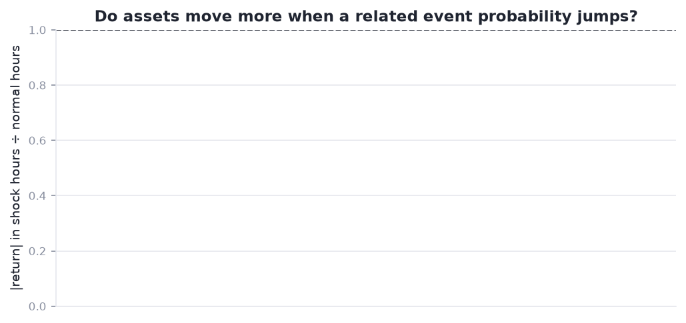

## V1 · Same-hour sensitivity

**Question.** When an event's probability jumps, do the assets linked to that event move more than unrelated assets?

**Verdict: INCONCLUSIVE.** In shock hours, related assets move +nan× (of normal-hour size) more than unrelated assets (95% CI +nan to +nan, 0 markets).

| metric | value |
|---|---|
| main.mean | n/a |
| main.low | n/a |
| main.high | n/a |
| main.groups | 0 |

Tables: [by_group](tables/by_group.csv), [per_market](tables/per_market.csv)

- Direction-free test (a market's YES can be good or bad news for an asset).
- Pass rule: mapped-minus-placebo ratio > 0 with the 95% CI above 0 (bootstrap over markets); fewer than 30 markets = inconclusive.
