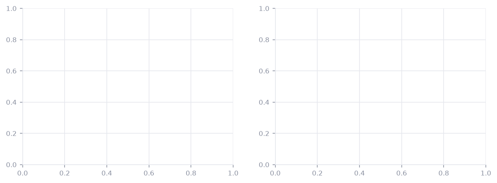

## V2 · Next-hour lead

**Question.** Does a probability shock tell us where the related asset goes in the following hour?

**Verdict: INCONCLUSIVE.** Next-hour direction after shocks: hit rate nan% (95% CI nan% to nan%, 0 markets). Next-hour size effect vs unrelated assets: +nan× (CI +nan to +nan).

| metric | value |
|---|---|
| direction.mean | n/a |
| direction.low | n/a |
| direction.high | n/a |
| direction.groups | 0 |
| next_hour_size.mean | n/a |
| next_hour_size.low | n/a |
| next_hour_size.high | n/a |
| next_hour_size.groups | 0 |

Tables: [per_market_hits](tables/per_market_hits.csv)

- Direction uses the sign of each market-asset co-movement estimated on earlier hours only.
- Pass rule (direction): hit rate above 50% with the 95% CI above 50%; < 30 markets = inconclusive. The size effect is reported as secondary (useful for a volatility warning).
