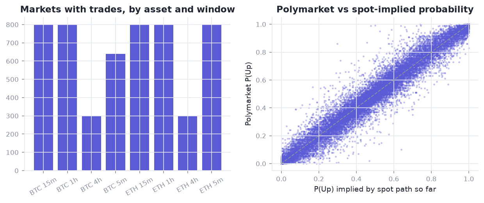

## C0 · G0 · Data and alignment

**Question.** Do we have enough crypto markets, and do their windows line up with the spot candles?

**Verdict: PASS.** 5239 markets with trades, 218,808 asset-minutes over 250 days; resolution matches Binance spot in 98.9% of markets that moved ≥ 2 bps (96.9% including near-ties).

| metric | value |
|---|---|
| markets_sampled | 5239 |
| markets_with_trades | 5239 |
| trades | 4632386 |
| wallets | 103456 |
| panel_minutes | 218808 |
| panel_days | 250 |
| outcome_vs_spot_agreement | 0.989 |
| agreement_including_near_ties | 0.9685 |
| window_shifts_s.BTC-15m | 0 |
| window_shifts_s.BTC-1h | 0 |
| window_shifts_s.BTC-4h | 0 |
| window_shifts_s.BTC-5m | 0 |
| window_shifts_s.ETH-15m | 0 |
| window_shifts_s.ETH-1h | 0 |
| window_shifts_s.ETH-4h | 0 |
| window_shifts_s.ETH-5m | 0 |
| corr_p_q | 0.9773 |

Tables: [alignment](tables/alignment.csv), [by_kind](tables/by_kind.csv), [coverage](tables/coverage.csv)

- Pass rule: ≥ 500 markets with trades and ≥ 95% agreement between the resolution and Binance close ≥ open over the market window, on markets whose spot move was at least 2 bps (some markets settle on Chainlink prices, so exact ties can differ).
- A window shift is applied only if it beats the documented window by 5+ points of agreement.
