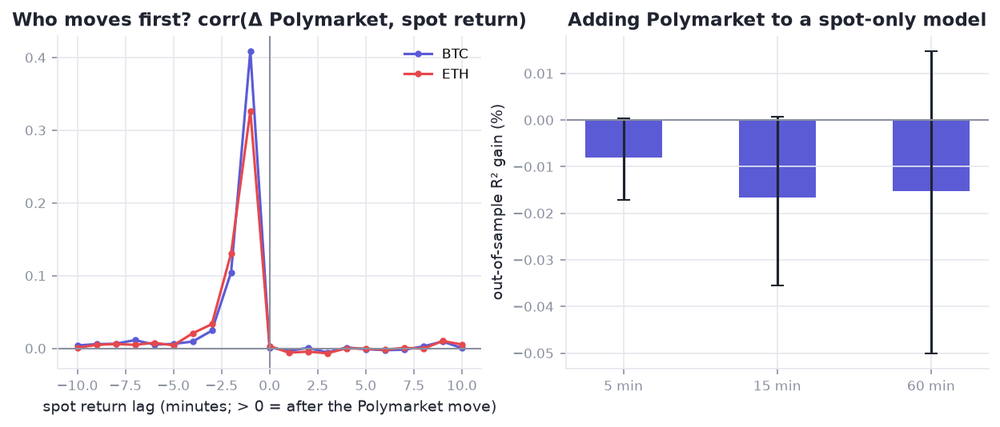

## C1 · G1 · Does Polymarket lead spot?

**Question.** Beyond what the spot path already says, does the Polymarket price predict the next spot return?

**Verdict: FAIL.** At 5 min, adding Polymarket's view changes out-of-sample R² by -0.008% (95% CI -0.017% to +0.000%, 229 test days); daily rank correlation +0.017.

| metric | value |
|---|---|
| main.gain | -7.978e-05 |
| main.low | -0.0001721 |
| main.high | 3.552e-06 |
| main.days | 229 |
| main.rows | 204555 |
| main.r2_model | -0.0004043 |
| main.r2_baseline | -0.0003245 |
| main.p_gain_le_0 | 0.9675 |
| ic_main.ic | 0.01724 |
| ic_main.low | 0.009146 |
| ic_main.high | 0.02585 |
| ic_main.days | 250 |
| coefficients_full_sample.intercept | 1.657e-06 |
| coefficients_full_sample.r_past | -0.01007 |
| coefficients_full_sample.u | -2.988e-06 |
| peak_lead_lag.asset | BTC |
| peak_lead_lag.lag_min | -1 |
| peak_lead_lag.corr | 0.409 |

Tables: [by_horizon](tables/by_horizon.csv), [lead_lag](tables/lead_lag.csv)

- Signal u = logit(Polymarket P(Up)) − logit(P(Up) implied by the spot path and recent volatility).
- Walk-forward by day (≥ 21 training days); CI by resampling test days.
- Pass rule: R² gain > 0 with the 95% CI above 0 at the main horizon; < 20 test days = inconclusive.
