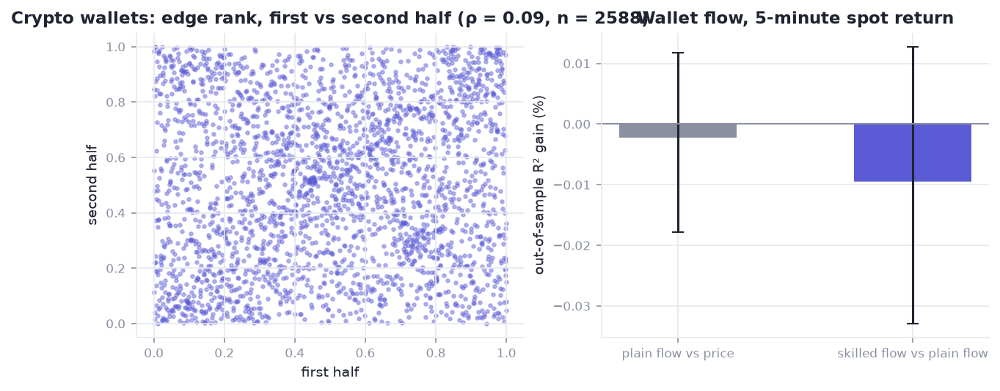

## C2 · G2 · Do skilled wallets lead?

**Question.** Does net buying by wallets with a proven record (judged only on earlier markets) predict spot?

**Verdict: FAIL.** Skilled-wallet flow changes out-of-sample R² by -0.009% beyond plain flow (95% CI -0.033% to +0.013%); crypto wallet edge persistence ρ = 0.09 (2588 wallets).

| metric | value |
|---|---|
| skill_over_flow.gain | -9.45e-05 |
| skill_over_flow.low | -0.000329 |
| skill_over_flow.high | 0.0001276 |
| skill_over_flow.days | 229 |
| skill_over_flow.rows | 204555 |
| skill_over_flow.r2_model | -0.0005213 |
| skill_over_flow.r2_baseline | -0.0004267 |
| skill_over_flow.p_gain_le_0 | 0.7825 |
| flow_over_price.gain | -2.237e-05 |
| flow_over_price.low | -0.0001783 |
| flow_over_price.high | 0.0001177 |
| flow_over_price.days | 229 |
| flow_over_price.rows | 204555 |
| flow_over_price.r2_model | -0.0004267 |
| flow_over_price.r2_baseline | -0.0004043 |
| flow_over_price.p_gain_le_0 | 0.619 |
| ic_top_flow.ic | -0.01629 |
| ic_top_flow.low | -0.03203 |
| ic_top_flow.high | -0.0006936 |
| ic_top_flow.days | 249 |
| persistence_rho | 0.08604 |
| persistence_wallets | 2588 |

Tables: [wallet_pairs](tables/wallet_pairs.csv)

- Top tier = top 10% of shrunk edge among wallets with ≥ 5 resolved crypto markets before the trade.
- Pass rule: skilled flow's R² gain over plain flow > 0 with the 95% CI above 0.
