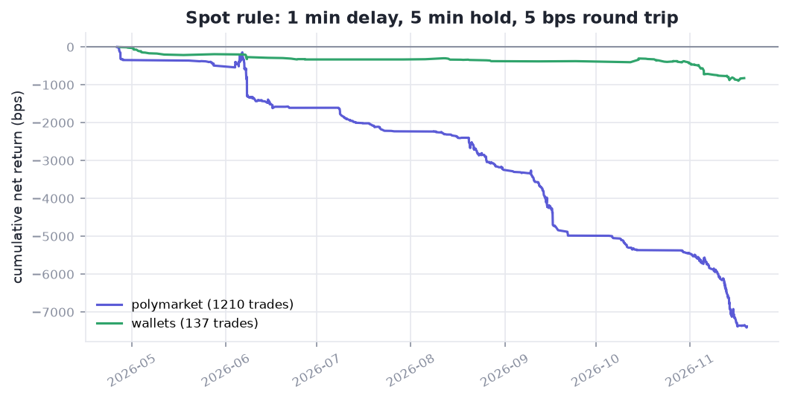

## C3 · G3 · Tradable after costs?

**Question.** Trading spot when the model's signal is strong, entering one minute late and paying fees: is it profitable?

**Verdict: FAIL.** Best rule (wallets) nets -6.01 bps per trade at 5 bps cost (95% CI -9.14 to -2.85, 137 trades).

| metric | value |
|---|---|
| main.signal | edge_polymarket |
| main.cost_bps | 5 |
| main.trades | 1210 |
| main.days | 107 |
| main.mean_bps | -6.099 |
| main.low | -7.36 |
| main.high | -4.84 |
| main.hit_rate | 0.2711 |
| main.gross_bps | -1.099 |
| best.signal | edge_wallets |
| best.cost_bps | 5 |
| best.trades | 137 |
| best.days | 63 |
| best.mean_bps | -6.008 |
| best.low | -9.14 |
| best.high | -2.852 |
| best.hit_rate | 0.2774 |
| best.gross_bps | -1.008 |

Tables: [rules](tables/rules.csv)

- Threshold: top 10% of |signal| on earlier days only; one open position per asset.
- Pass rule: any rule with mean net return > 0 and CI above 0 at 5 bps; 20 bps (retail taker fees) is reported too. < 100 trades = inconclusive.
