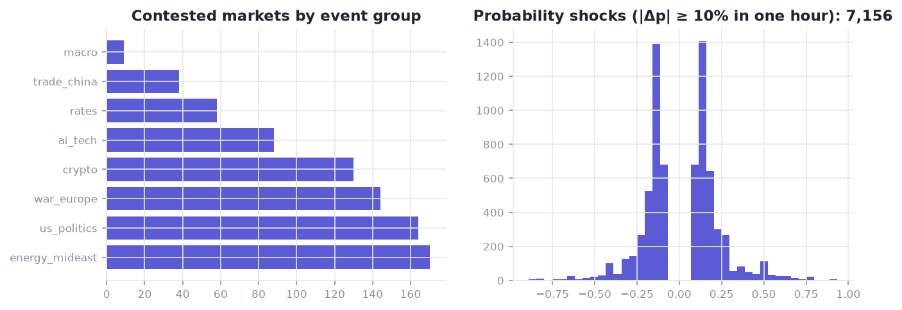

## V0 · Data

**Question.** Are there enough contested event markets overlapping with asset trading hours?

**Verdict: PASS.** 689 event markets aligned with hourly prices of 26 assets; 7,156 shock hours.

| metric | value |
|---|---|
| markets | 689 |
| markets_with_aligned_assets | 689 |
| pairs | 4345 |
| shock_hours | 7156 |
| asset_series | 26 |

Tables: [groups](tables/groups.csv)

- Pass rule: ≥ 100 markets with aligned mapped assets.
