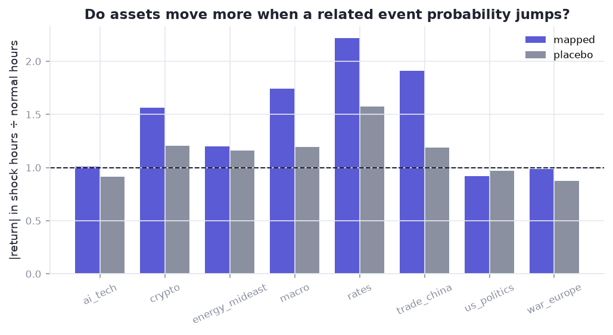

## V1 · Same-hour sensitivity

**Question.** When an event's probability jumps, do the assets linked to that event move more than unrelated assets?

**Verdict: PASS.** In shock hours, related assets move +0.25× (of normal-hour size) more than unrelated assets (95% CI +0.15 to +0.34, 366 markets). Without crypto-price markets: +0.22× (CI +0.11 to +0.34).

| metric | value |
|---|---|
| main.mean | 0.2471 |
| main.low | 0.1482 |
| main.high | 0.3435 |
| main.n | 366 |
| main.groups | 366 |
| main.p_two_sided | 0 |
| without_crypto_price_markets.mean | 0.2162 |
| without_crypto_price_markets.low | 0.1063 |
| without_crypto_price_markets.high | 0.3363 |
| without_crypto_price_markets.n | 288 |
| without_crypto_price_markets.groups | 288 |
| without_crypto_price_markets.p_two_sided | 0 |
| crypto_price_markets_only.mean | 0.361 |
| crypto_price_markets_only.low | 0.1936 |
| crypto_price_markets_only.high | 0.5386 |
| crypto_price_markets_only.n | 78 |
| crypto_price_markets_only.groups | 78 |
| crypto_price_markets_only.p_two_sided | 0 |

Tables: [by_group](tables/by_group.csv), [per_market](tables/per_market.csv)

- Direction-free test (a market's YES can be good or bad news for an asset).
- Pass rule: mapped-minus-placebo ratio > 0 with the 95% CI above 0 (bootstrap over markets); fewer than 30 markets = inconclusive.
