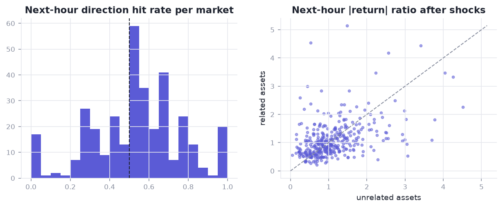

## V2 · Next-hour lead

**Question.** Does a probability shock tell us where the related asset goes in the following hour?

**Verdict: PASS.** Next-hour direction after shocks: hit rate 53.1% (95% CI 50.6% to 55.5%, 343 markets). Next-hour size effect vs unrelated assets: -0.01× (CI -0.08 to +0.06).

| metric | value |
|---|---|
| direction.mean | 0.03149 |
| direction.low | 0.006092 |
| direction.high | 0.05468 |
| direction.n | 343 |
| direction.groups | 343 |
| direction.p_two_sided | 0.014 |
| next_hour_size.mean | -0.008494 |
| next_hour_size.low | -0.08053 |
| next_hour_size.high | 0.06371 |
| next_hour_size.n | 366 |
| next_hour_size.groups | 366 |
| next_hour_size.p_two_sided | 0.8205 |

Tables: [per_market_hits](tables/per_market_hits.csv)

- Direction uses the sign of each market-asset co-movement estimated on earlier hours only.
- Pass rule (direction): hit rate above 50% with the 95% CI above 50%; < 30 markets = inconclusive. The size effect is reported as secondary (useful for a volatility warning).
