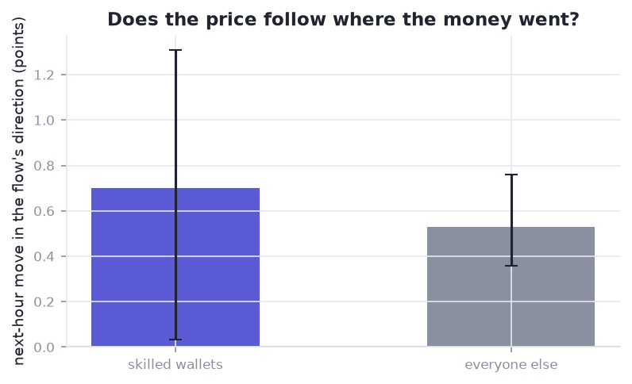

## V3 · Skilled wallets lead the probability

**Question.** Does net buying by skilled wallets predict the next hour's probability move?

**Verdict: PASS.** After an hour of net skilled-wallet buying (≥ $500), the probability moves +0.70 points their way next hour (95% CI +0.03 to +1.31, 170 markets); everyone else: +0.53.

| metric | value |
|---|---|
| top_flow.mean | 0.007012 |
| top_flow.low | 0.000344 |
| top_flow.high | 0.01307 |
| top_flow.n | 1091 |
| top_flow.groups | 170 |
| top_flow.p_two_sided | 0.0345 |
| rest_flow.mean | 0.00528 |
| rest_flow.low | 0.003582 |
| rest_flow.high | 0.007582 |
| rest_flow.n | 11458 |
| rest_flow.groups | 298 |
| rest_flow.p_two_sided | 0 |

- Skill is point-in-time (topic F's timeline: markets closed before each trade).
- Pass rule: skilled-flow signed next-hour move > 0 with the 95% CI above 0; < 30 markets = inconclusive.
