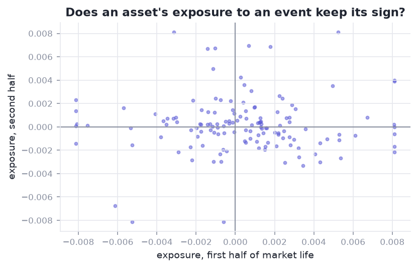

## V4 · Stable exposures

**Question.** If an asset rose with an event's probability early on, does it still do so later?

**Verdict: FAIL.** Exposure keeps its sign in 44% of related market-asset pairs (95% CI 34% to 54%, 42 markets).

| metric | value |
|---|---|
| main.mean | -0.06115 |
| main.low | -0.1613 |
| main.high | 0.04033 |
| main.n | 139 |
| main.groups | 42 |
| main.p_two_sided | 0.242 |
| pairs | 139 |

Tables: [pairs](tables/pairs.csv)

- Exposure = slope of hourly asset return on hourly change in the event's log-odds.
- Pass rule: sign agreement above 50% with the 95% CI above 50%.
