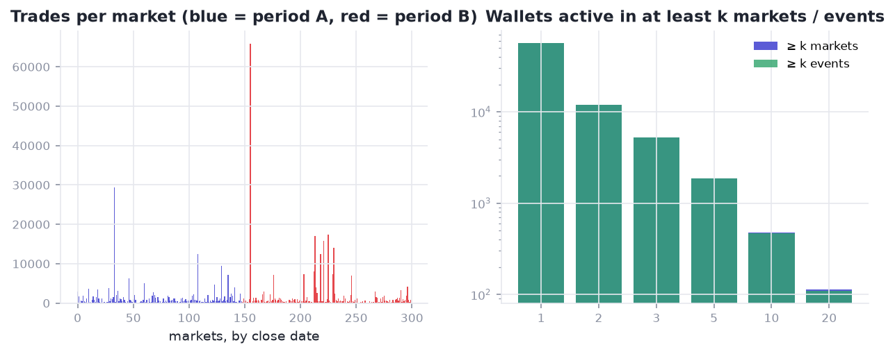

## E0 · Dataset overview

**Question.** What does the data cover, and do enough wallets trade many markets to measure skill?

**Verdict: DESCRIPTIVE.** 300 markets in 294 events, 489,682 trades by 56,852 wallets; 1,877 wallets traded 5+ markets and the top 1% of wallets did 61% of the volume.

| metric | value |
|---|---|
| markets | 300 |
| events | 294 |
| trades | 489682 |
| wallets | 56852 |
| first_close | 2024-11-15 |
| last_close | 2026-10-31 |
| split_date | 2026-03-01 |
| period_a_markets | 148 |
| period_b_markets | 152 |
| top_1pct_wallets_share_of_volume | 0.6136 |
| wallets_with_5plus_markets | 1877 |
| wallets_with_3plus_events | 5248 |
| yes_resolution_rate | 0.3967 |

Tables: [markets](tables/markets.csv), [wallet_repeat](tables/wallet_repeat.csv)

- Trade rows are participant records: each fill appears once for every wallet in it.
- Dataset source: collector
