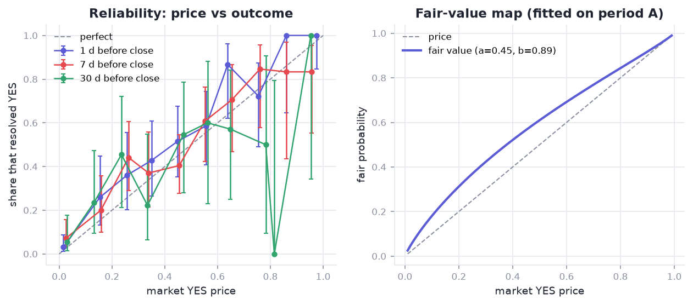

## E1 · Calibration and fair value (H0)

**Question.** Do YES prices match how often YES happens, and can a simple recalibration improve them?

**Verdict: DESCRIPTIVE.** Prices are off by 6.6% on average across buckets; the fair-value map (b = 0.89) does not improve period-B log loss (0.5040 → 0.5102).

| metric | value |
|---|---|
| points | 691 |
| markets | 300 |
| mean_abs_gap | 0.06641 |
| brier_by_horizon.1d | 0.1414 |
| brier_by_horizon.7d | 0.1835 |
| brier_by_horizon.30d | 0.1653 |
| fair_value.a | 0.4468 |
| fair_value.b | 0.8923 |
| fair_value.n | 343 |
| fair_value.fitted | True |
| period_b_logloss_market | 0.504 |
| period_b_logloss_fair | 0.5102 |
| period_b_logloss_improvement | -0.006232 |

Tables: [brier](tables/brier.csv), [reliability](tables/reliability.csv)

- Fair value is fitted on period A only and used for every edge measure in E2–E4.
- Points from different horizons of the same market are not independent.
