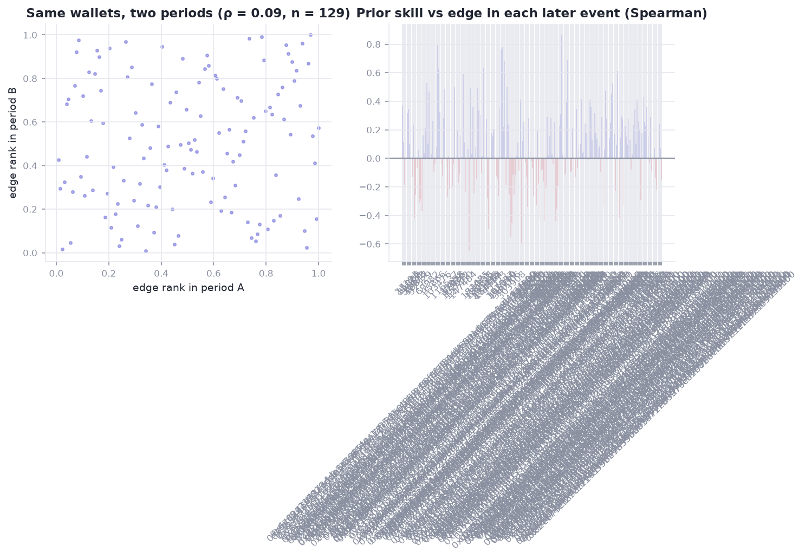

## E2 · Skill persistence (H1)

**Question.** Do wallets with high edge in earlier markets also have high edge in later markets?

**Verdict: FAIL.** Spearman ρ between period-A and period-B edge = 0.086 (95% CI -0.106 to 0.267, permutation p = 0.1588, 129 wallets with ≥ 5 markets in each period). Holding long-shot style fixed: ρ = 0.085.

| metric | value |
|---|---|
| edge_vs_fair.rho | 0.08607 |
| edge_vs_fair.p_one_sided | 0.1588 |
| edge_vs_fair.low | -0.1061 |
| edge_vs_fair.high | 0.2674 |
| edge_vs_fair.n | 129 |
| edge_vs_price.rho | 0.0949 |
| edge_vs_price.p_one_sided | 0.1439 |
| edge_vs_price.low | -0.09188 |
| edge_vs_price.high | 0.2947 |
| edge_vs_price.n | 129 |
| partial_longshot.rho | 0.08529 |
| partial_longshot.n | 129 |
| rolling_mean_rho | 0.08074 |
| rolling_events | 214 |
| min_markets_per_period | 5 |

Tables: [rolling](tables/rolling.csv), [wallet_pairs](tables/wallet_pairs.csv)

- Pass rule (pre-registered): ρ > 0 with permutation p < 0.05; fewer than 30 wallets = inconclusive.
- Edge is measured against fair value from E1; the raw-price version is reported for comparison.
