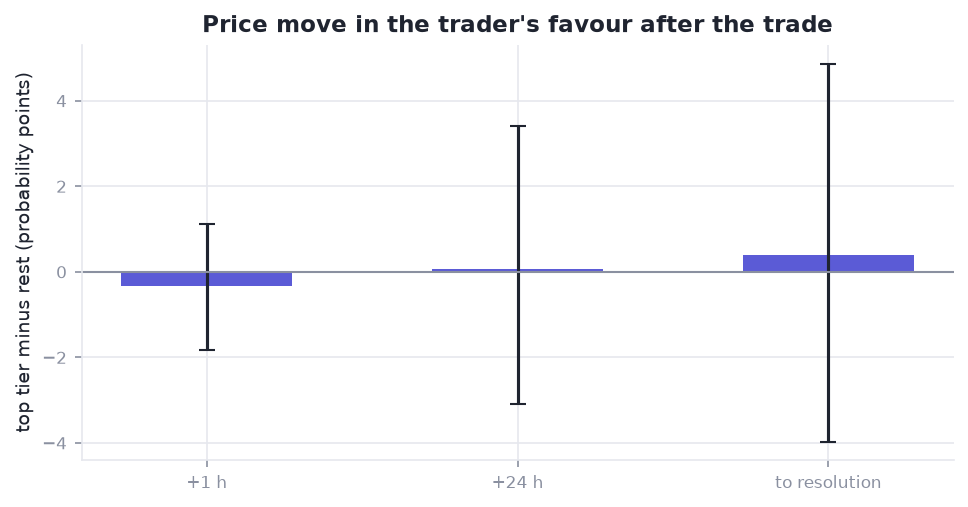

## E3 · Information in skilled wallets' trades (H2)

**Question.** Is the price more likely to move in a trade's direction when the trader has proven skill?

**Verdict: FAIL.** Top-tier trades beat other trades by +0.39 points to resolution (95% CI -3.97 to +4.87; 128 markets, 125 events).

| metric | value |
|---|---|
| main.sample | band |
| main.weighting | equal |
| main.horizon | markout_res |
| main.top_mean | 0.005545 |
| main.rest_mean | 0.001678 |
| main.diff | 0.003867 |
| main.low | -0.03967 |
| main.high | 0.0487 |
| main.p | 0.871 |
| main.markets | 128 |
| main.events | 125 |
| top_tier_share_of_trades | 0.03168 |
| period_b_trades | 289456 |
| banded_trades | 233173 |

Tables: [markout_tests](tables/markout_tests.csv), [per_market_main](tables/per_market_main.csv), [tier_means_pct_points](tables/tier_means_pct_points.csv)

- Skill tier is decided with markets closed before each trade (walk-forward).
- Main test (pre-registered): trades with YES price in the band, equal weight, to resolution; per-market differences, bootstrap over events. Fewer than 5 events or 10 markets = inconclusive.
