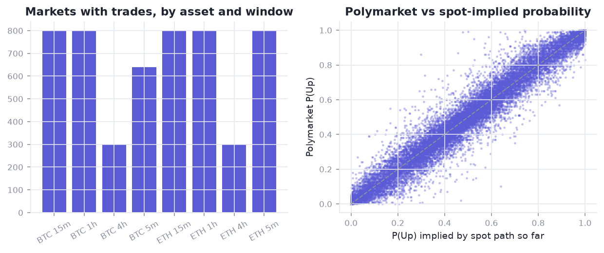
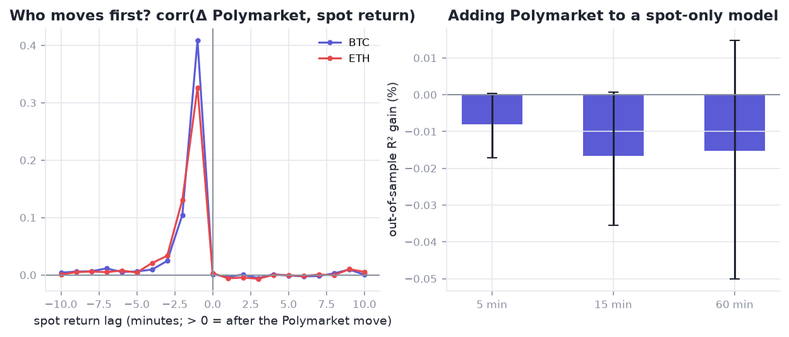
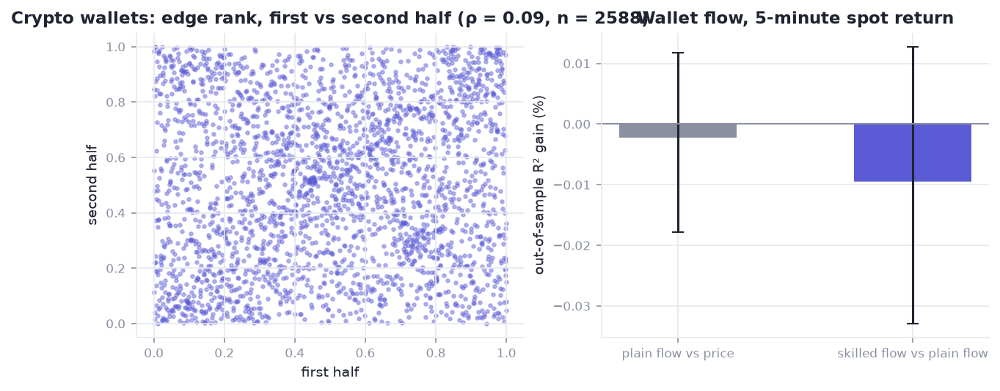
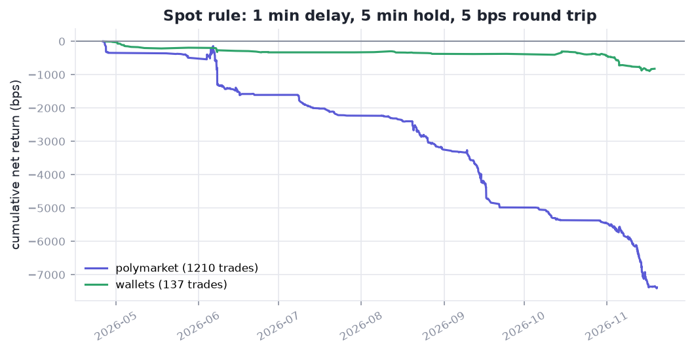

# T1 · Polymarket crypto markets as a lead signal for BTC/ETH

Run `20261127-001943_crypto` on dataset **crypto**.

| Experiment | Verdict | Headline |
|---|---|---|
| [C0 G0 · Data and alignment](c0/summary.md) | **pass** | 5239 markets with trades, 218,808 asset-minutes over 250 days; resolution matches Binance spot in 98.9% of markets that moved ≥ 2 bps (96.9% including near-ties). |
| [C1 G1 · Does Polymarket lead spot?](c1/summary.md) | **fail** | At 5 min, adding Polymarket's view changes out-of-sample R² by -0.008% (95% CI -0.017% to +0.000%, 229 test days); daily rank correlation +0.017. |
| [C2 G2 · Do skilled wallets lead?](c2/summary.md) | **fail** | Skilled-wallet flow changes out-of-sample R² by -0.009% beyond plain flow (95% CI -0.033% to +0.013%); crypto wallet edge persistence ρ = 0.09 (2588 wallets). |
| [C3 G3 · Tradable after costs?](c3/summary.md) | **fail** | Best rule (wallets) nets -6.01 bps per trade at 5 bps cost (95% CI -9.14 to -2.85, 137 trades). |

**Decision (pre-registered rule):** T1 fails: Polymarket crypto markets do not lead spot. Move to T2 (event shocks -> assets).

## C0 · G0 · Data and alignment

**Question.** Do we have enough crypto markets, and do their windows line up with the spot candles?

**Verdict: PASS.** 5239 markets with trades, 218,808 asset-minutes over 250 days; resolution matches Binance spot in 98.9% of markets that moved ≥ 2 bps (96.9% including near-ties).

| metric | value |
|---|---|
| markets_sampled | 5239 |
| markets_with_trades | 5239 |
| trades | 4632386 |
| wallets | 103456 |
| panel_minutes | 218808 |
| panel_days | 250 |
| outcome_vs_spot_agreement | 0.989 |
| agreement_including_near_ties | 0.9685 |
| window_shifts_s.BTC-15m | 0 |
| window_shifts_s.BTC-1h | 0 |
| window_shifts_s.BTC-4h | 0 |
| window_shifts_s.BTC-5m | 0 |
| window_shifts_s.ETH-15m | 0 |
| window_shifts_s.ETH-1h | 0 |
| window_shifts_s.ETH-4h | 0 |
| window_shifts_s.ETH-5m | 0 |
| corr_p_q | 0.9773 |

Tables: [alignment](c0/tables/alignment.csv), [by_kind](c0/tables/by_kind.csv), [coverage](c0/tables/coverage.csv)

- Pass rule: ≥ 500 markets with trades and ≥ 95% agreement between the resolution and Binance close ≥ open over the market window, on markets whose spot move was at least 2 bps (some markets settle on Chainlink prices, so exact ties can differ).
- A window shift is applied only if it beats the documented window by 5+ points of agreement.

## C1 · G1 · Does Polymarket lead spot?

**Question.** Beyond what the spot path already says, does the Polymarket price predict the next spot return?

**Verdict: FAIL.** At 5 min, adding Polymarket's view changes out-of-sample R² by -0.008% (95% CI -0.017% to +0.000%, 229 test days); daily rank correlation +0.017.

| metric | value |
|---|---|
| main.gain | -7.978e-05 |
| main.low | -0.0001721 |
| main.high | 3.552e-06 |
| main.days | 229 |
| main.rows | 204555 |
| main.r2_model | -0.0004043 |
| main.r2_baseline | -0.0003245 |
| main.p_gain_le_0 | 0.9675 |
| ic_main.ic | 0.01724 |
| ic_main.low | 0.009146 |
| ic_main.high | 0.02585 |
| ic_main.days | 250 |
| coefficients_full_sample.intercept | 1.657e-06 |
| coefficients_full_sample.r_past | -0.01007 |
| coefficients_full_sample.u | -2.988e-06 |
| peak_lead_lag.asset | BTC |
| peak_lead_lag.lag_min | -1 |
| peak_lead_lag.corr | 0.409 |

Tables: [by_horizon](c1/tables/by_horizon.csv), [lead_lag](c1/tables/lead_lag.csv)

- Signal u = logit(Polymarket P(Up)) − logit(P(Up) implied by the spot path and recent volatility).
- Walk-forward by day (≥ 21 training days); CI by resampling test days.
- Pass rule: R² gain > 0 with the 95% CI above 0 at the main horizon; < 20 test days = inconclusive.

## C2 · G2 · Do skilled wallets lead?

**Question.** Does net buying by wallets with a proven record (judged only on earlier markets) predict spot?

**Verdict: FAIL.** Skilled-wallet flow changes out-of-sample R² by -0.009% beyond plain flow (95% CI -0.033% to +0.013%); crypto wallet edge persistence ρ = 0.09 (2588 wallets).

| metric | value |
|---|---|
| skill_over_flow.gain | -9.45e-05 |
| skill_over_flow.low | -0.000329 |
| skill_over_flow.high | 0.0001276 |
| skill_over_flow.days | 229 |
| skill_over_flow.rows | 204555 |
| skill_over_flow.r2_model | -0.0005213 |
| skill_over_flow.r2_baseline | -0.0004267 |
| skill_over_flow.p_gain_le_0 | 0.7825 |
| flow_over_price.gain | -2.237e-05 |
| flow_over_price.low | -0.0001783 |
| flow_over_price.high | 0.0001177 |
| flow_over_price.days | 229 |
| flow_over_price.rows | 204555 |
| flow_over_price.r2_model | -0.0004267 |
| flow_over_price.r2_baseline | -0.0004043 |
| flow_over_price.p_gain_le_0 | 0.619 |
| ic_top_flow.ic | -0.01629 |
| ic_top_flow.low | -0.03203 |
| ic_top_flow.high | -0.0006936 |
| ic_top_flow.days | 249 |
| persistence_rho | 0.08604 |
| persistence_wallets | 2588 |

Tables: [wallet_pairs](c2/tables/wallet_pairs.csv)

- Top tier = top 10% of shrunk edge among wallets with ≥ 5 resolved crypto markets before the trade.
- Pass rule: skilled flow's R² gain over plain flow > 0 with the 95% CI above 0.

## C3 · G3 · Tradable after costs?

**Question.** Trading spot when the model's signal is strong, entering one minute late and paying fees: is it profitable?

**Verdict: FAIL.** Best rule (wallets) nets -6.01 bps per trade at 5 bps cost (95% CI -9.14 to -2.85, 137 trades).

| metric | value |
|---|---|
| main.signal | edge_polymarket |
| main.cost_bps | 5 |
| main.trades | 1210 |
| main.days | 107 |
| main.mean_bps | -6.099 |
| main.low | -7.36 |
| main.high | -4.84 |
| main.hit_rate | 0.2711 |
| main.gross_bps | -1.099 |
| best.signal | edge_wallets |
| best.cost_bps | 5 |
| best.trades | 137 |
| best.days | 63 |
| best.mean_bps | -6.008 |
| best.low | -9.14 |
| best.high | -2.852 |
| best.hit_rate | 0.2774 |
| best.gross_bps | -1.008 |

Tables: [rules](c3/tables/rules.csv)

- Threshold: top 10% of |signal| on earlier days only; one open position per asset.
- Pass rule: any rule with mean net return > 0 and CI above 0 at 5 bps; 20 bps (retail taker fees) is reported too. < 100 trades = inconclusive.
