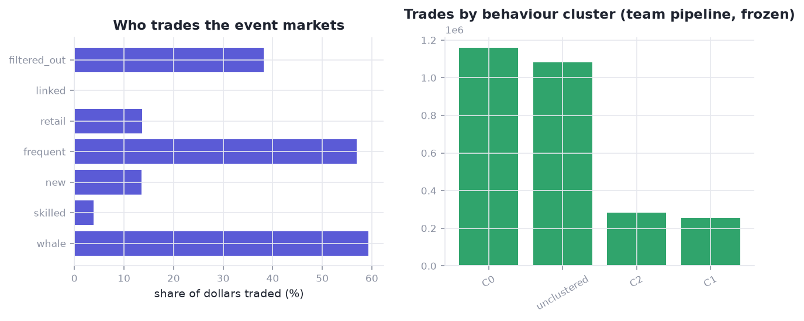
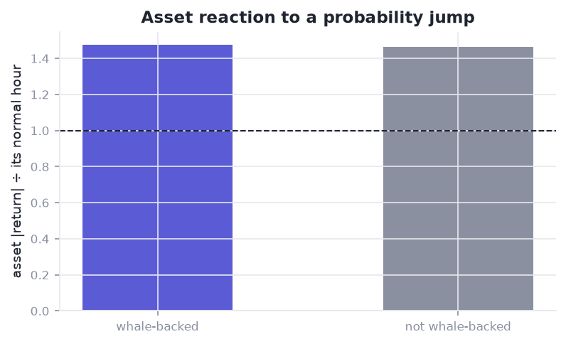
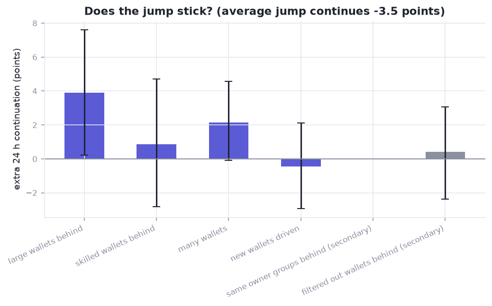
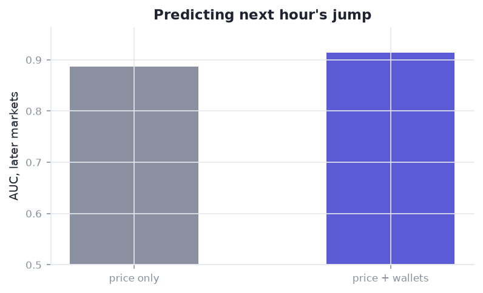
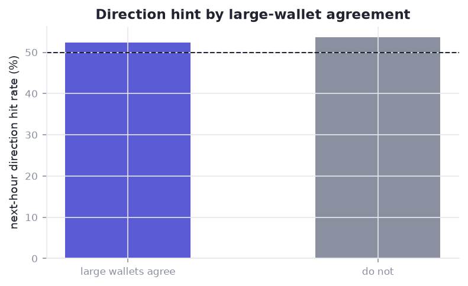
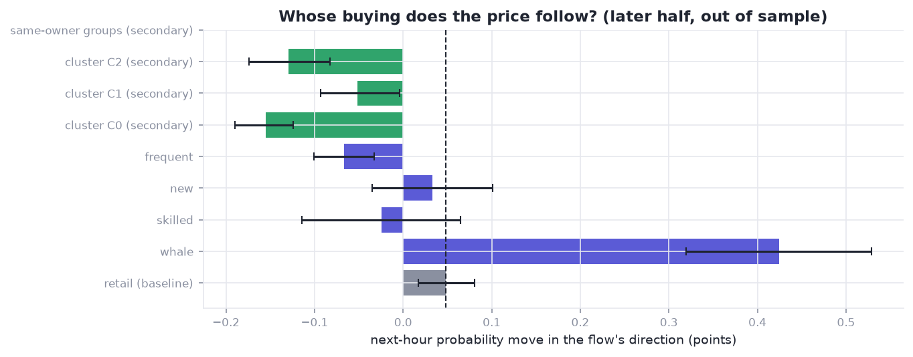

# T2-W · Can wallets help the event-risk monitor?

Run `20261127-013354_wallets_events` on dataset **events**.

| Experiment | Verdict | Headline |
|---|---|---|
| [W0 Wallet data](w0/summary.md) | **pass** | 2,777,538 trades by 147,076 wallets in 689 event markets; 1880 probability jumps with trades in the same hour. Team pipeline: 2 same-owner groups, 9878 entities pass the hard rules, 3 behaviour clusters. |
| [W1 Large-wallet confirmation](w1/summary.md) | **fail** | Related assets react +0.01× (of a normal hour) more when large wallets back the jump (95% CI -0.28 to +0.36; 822 vs 2548 jump-asset pairs, 308 markets). Same-owner groups backing it: +nan× (CI +nan to +nan). |
| [W2 Will the jump stick?](w2/summary.md) | **pass** | 1880 jumps; on average they continue -3.5 points over 24 h. Significant (Bonferroni): large wallets behind +3.9 pts (CI +0.2 to +7.6) |
| [W3 Early warning](w3/summary.md) | **pass** | Out of time, adding wallet activity moves the AUC from 0.887 to 0.914 (gain +0.027, 95% CI +0.018 to +0.038); the 5% most unusual hours are followed by a jump 12.8× as often as average. |
| [W4 Large wallets and the direction hint](w4/summary.md) | **fail** | Direction hint hit rate 52.3% when large wallets agree vs 53.6% otherwise (difference -1.3 points, 95% CI -6.2 to +3.2; 805 vs 2334). |
| [W5 Whose buying leads?](w5/summary.md) | **pass** | After retail buying the price follows +0.05 points next hour. Beating that (Bonferroni CI above retail): whale +0.42. |

**Decision (pre-registered rule):** Wallet features that passed and go into the product: W2: label jumps likely to stick or revert by who is behind them; W3: early warning from unusual wallet activity; W5: highlight the wallet type whose buying leads the price.

## W0 · Wallet data

**Question.** Is there enough wallet-level data around probability jumps to test W1-W5?

**Verdict: PASS.** 2,777,538 trades by 147,076 wallets in 689 event markets; 1880 probability jumps with trades in the same hour. Team pipeline: 2 same-owner groups, 9878 entities pass the hard rules, 3 behaviour clusters.

| metric | value |
|---|---|
| trades | 2777538 |
| wallets | 147076 |
| markets | 689 |
| market_hours | 1310112 |
| shocks_with_flow | 1880 |
| pipeline.wallets | 74230 |
| pipeline.linked_pairs | 3 |
| pipeline.merged_entities | 2 |
| pipeline.rule_counts.entities | 74227 |
| pipeline.rule_counts.eligible | 9878 |
| pipeline.rule_counts.fewer_than_min_trades | 63207 |
| pipeline.rule_counts.fewer_than_min_active_days | 51898 |
| pipeline.clustering.selected_k | 3 |
| pipeline.clustering.selected_seed | 43 |
| pipeline.clustering.mean_silhouette | 0.1935 |
| pipeline.clustering.seed_stability_ari | 0.9995 |
| pipeline.clustering.size_valid | True |
| pipeline.clustering.minimum_cluster_size | 494 |
| pipeline.clustering.status | fitted |
| pipeline.clustering.removed_features | ['taker_fraction', 'late_activity_fraction'] |
| pipeline.clustering.fit_entities | 9878 |
| pipeline.clustering.cluster_sizes.C0 | 1193 |
| pipeline.clustering.cluster_sizes.C1 | 5076 |
| pipeline.clustering.cluster_sizes.C2 | 3609 |
| cluster_explanations.C0 | higher active days; higher markets traded; higher two sided token fraction |
| cluster_explanations.C1 | higher median gap hours; lower trades per active day; lower busiest day trade fraction |
| cluster_explanations.C2 | higher busiest day trade fraction; higher trades per active day; higher top market notional fraction |

Tables: [clusters](w0/tables/clusters.csv), [pipeline_wallets](w0/tables/pipeline_wallets.csv), [type_shares](w0/tables/type_shares.csv)

- Pass rule: ≥ 100 markets with trades and ≥ 300 jumps with same-hour trades.
- Behaviour clusters are fitted on trades before the median market close and then frozen (team pipeline).
- Types are not exclusive except retail; trade shares: whale 7.0%, skilled 3.9%, new 15.7%, frequent 47.4%, retail 32.8%, linked 0.0%, filtered_out 39.0%.

## W1 · Large-wallet confirmation

**Question.** When a jump is pushed by trades of ≥ $5,000 in its direction, do the related assets move more?

**Verdict: FAIL.** Related assets react +0.01× (of a normal hour) more when large wallets back the jump (95% CI -0.28 to +0.36; 822 vs 2548 jump-asset pairs, 308 markets). Same-owner groups backing it: +nan× (CI +nan to +nan).

| metric | value |
|---|---|
| whale_backed.diff | 0.008857 |
| whale_backed.low | -0.2787 |
| whale_backed.high | 0.3607 |
| whale_backed.mean_high_group | 1.474 |
| whale_backed.mean_low_group | 1.465 |
| whale_backed.n_high | 822 |
| whale_backed.n_low | 2548 |
| whale_backed.markets | 308 |
| same_owner_group_backed.diff | n/a |
| same_owner_group_backed.low | n/a |
| same_owner_group_backed.high | n/a |
| same_owner_group_backed.n_high | 0 |
| same_owner_group_backed.n_low | 3370 |
| same_owner_group_backed.markets | 308 |

- Pass rule (pre-registered): whale-backed minus other jumps > 0, 95% CI above 0, resampling markets.
- Same-owner groups come from the team's sniper grouping; reported as secondary.

## W2 · Will the jump stick?

**Question.** Do jumps backed by large, skilled, many or new wallets hold up better (or worse) over the next day?

**Verdict: PASS.** 1880 jumps; on average they continue -3.5 points over 24 h. Significant (Bonferroni): large wallets behind +3.9 pts (CI +0.2 to +7.6)

| metric | value |
|---|---|
| jumps | 1880 |
| mean_continuation | -0.03514 |
| splits | [{'split': 'large_wallets_behind', 'diff': 0.038993420103683216, 'low': 0.00215043985782438, 'high': 0.07613647280900579, 'mean_high_group': -0.0023305369127516722, 'mean_low_group': -0.04132395701643489, 'n_high': 298, 'n_low': 1582, 'markets': 445}, {'split': 'skilled_wallets_behind', 'diff': 0.00872129129982013, 'low': -0.028139584354058066, 'high': 0.04708303661827298, 'mean_high_group': -0.02814285714285714, 'mean_low_group': -0.03686414844267727, 'n_high': 371, 'n_low': 1509, 'markets': 445}, {'split': 'many_wallets', 'diff': 0.02148527245949926, 'low': -0.0009656881864659628, 'high': 0.045770594657840655, 'mean_high_group': -0.024743298969072163, 'mean_low_group': -0.046228571428571424, 'n_high': 970, 'n_low': 910, 'markets': 445}, {'split': 'new_wallets_driven', 'diff': -0.004397872340425518, 'low': -0.02927056946842571, 'high': 0.021194381863295038, 'mean_high_group': -0.037342021276595735, 'mean_low_group': -0.03294414893617022, 'n_high': 940, 'n_low': 940, 'markets': 445}, {'split': 'same_owner_groups_behind (secondary)', 'diff': nan, 'low': nan, 'high': nan, 'mean_high_group': nan, 'mean_low_group': nan, 'n_high': 0, 'n_low': 1880, 'markets': 445}, {'split': 'filtered_out_wallets_behind (secondary)', 'diff': 0.0040992013255055845, 'low': -0.023674805836162213, 'high': 0.030607815168326353, 'mean_high_group': -0.032620331950207464, 'mean_low_group': -0.03671953327571305, 'n_high': 723, 'n_low': 1157, 'markets': 445}] |

Tables: [splits](w2/tables/splits.csv)

- Pass rule (pre-registered): any of the four main splits with a 98.75% CI (Bonferroni for 4 tests) excluding 0, in either direction; a reliable 'likely to revert' label is as useful as 'likely to stick'.
- Same-owner groups and filtered-out wallets (team pipeline) are reported as secondary splits.

## W3 · Early warning

**Question.** Does unusual wallet activity this hour warn of a probability jump next hour, beyond recent price moves?

**Verdict: PASS.** Out of time, adding wallet activity moves the AUC from 0.887 to 0.914 (gain +0.027, 95% CI +0.018 to +0.038); the 5% most unusual hours are followed by a jump 12.8× as often as average.

| metric | value |
|---|---|
| auc_price_only | 0.8866 |
| auc_with_wallets | 0.9139 |
| gain | 0.02733 |
| low | 0.01796 |
| high | 0.03829 |
| top5pct_lift | 12.82 |
| coefficients.intercept | -7.237 |
| coefficients.abs_dp | 0.1342 |
| coefficients.recent_vol | 0.3695 |
| coefficients.gross_z | 0.0756 |
| coefficients.whale_z | -0.0814 |
| coefficients.wallets_z | 0.8544 |
| coefficients.new_z | 0.008 |
| coefficients.imbalance | -0.1464 |
| train_hours | 699265 |
| test_hours | 602579 |
| test_jumps | 1718 |

- Trained on earlier-closing markets, tested on later-closing ones.
- Pass rule (pre-registered): AUC gain over the price-only model > 0 with the 95% CI above 0 (markets resampled).

## W4 · Large wallets and the direction hint

**Question.** Does V2's next-hour direction hint work better when large wallets push the jump?

**Verdict: FAIL.** Direction hint hit rate 52.3% when large wallets agree vs 53.6% otherwise (difference -1.3 points, 95% CI -6.2 to +3.2; 805 vs 2334).

| metric | value |
|---|---|
| agree_vs_not.diff | -0.01301 |
| agree_vs_not.low | -0.06175 |
| agree_vs_not.high | 0.03193 |
| agree_vs_not.mean_high_group | 0.523 |
| agree_vs_not.mean_low_group | 0.536 |
| agree_vs_not.n_high | 805 |
| agree_vs_not.n_low | 2334 |
| agree_vs_not.markets | 291 |
| agree_hit_rate_minus_half.mean | 0.02298 |
| agree_hit_rate_minus_half.low | -0.01824 |
| agree_hit_rate_minus_half.high | 0.06155 |
| agree_hit_rate_minus_half.n | 805 |
| agree_hit_rate_minus_half.groups | 135 |
| agree_hit_rate_minus_half.p_two_sided | 0.2545 |

- Pass rule (pre-registered): agree minus not-agree hit rate > 0 with the 95% CI above 0 (markets resampled).

## W5 · Whose buying leads?

**Question.** Is there a wallet type (or behaviour cluster) whose buying the probability follows more than retail's?

**Verdict: PASS.** After retail buying the price follows +0.05 points next hour. Beating that (Bonferroni CI above retail): whale +0.42.

| metric | value |
|---|---|
| by_type | [{'type': 'retail (baseline)', 'mean': 0.0004836724935660343, 'low': 0.00017516484229197963, 'high': 0.0008058478509032093, 'n': 71107, 'groups': 339, 'p_two_sided': 0.003}, {'type': 'whale', 'mean': 0.004242106280193237, 'low': 0.003194868097455796, 'high': 0.005289344462930679, 'n': 25875, 'groups': 313, 'p_two_sided': 0.0}, {'type': 'skilled', 'mean': -0.0002443303061882784, 'low': -0.0011391460980844273, 'high': 0.0006504854857078703, 'n': 20151, 'groups': 312, 'p_two_sided': 0.4535}, {'type': 'new', 'mean': 0.00033053262578616353, 'low': -0.0003509222249558737, 'high': 0.0010119874765282008, 'n': 30528, 'groups': 333, 'p_two_sided': 0.1965}, {'type': 'frequent', 'mean': -0.0006680820725074767, 'low': -0.0010103664787457147, 'high': -0.0003257976662692386, 'n': 79247, 'groups': 332, 'p_two_sided': 0.0}, {'type': 'cluster C0 (secondary)', 'mean': -0.0015511181856865926, 'low': -0.0018977799409839178, 'high': -0.0012393793123346307, 'n': 63451, 'groups': 319, 'p_two_sided': 0.0}, {'type': 'cluster C1 (secondary)', 'mean': -0.0005150427637095422, 'low': -0.00093065730621008, 'high': -3.89800133677262e-05, 'n': 29815, 'groups': 324, 'p_two_sided': 0.0245}, {'type': 'cluster C2 (secondary)', 'mean': -0.00129765054503122, 'low': -0.001737352281307513, 'high': -0.0008258229132914362, 'n': 28347, 'groups': 322, 'p_two_sided': 0.0}, {'type': 'same-owner groups (secondary)', 'mean': nan, 'low': nan, 'high': nan, 'n': 0, 'groups': 0, 'p_two_sided': nan}] |
| regression_points.intercept | 0.009 |
| regression_points.f_retail | 0.035 |
| regression_points.f_whale | 0.463 |
| regression_points.f_skilled | -0.028 |
| regression_points.f_new | 0.004 |
| regression_points.f_frequent | -0.108 |
| cluster_explanations.C0 | higher active days; higher markets traded; higher two sided token fraction |
| cluster_explanations.C1 | higher median gap hours; lower trades per active day; lower busiest day trade fraction |
| cluster_explanations.C2 | higher busiest day trade fraction; higher trades per active day; higher top market notional fraction |

Tables: [by_type](w5/tables/by_type.csv)

- Tested on the later half of the data only, since the behaviour clusters are fitted on the earlier half.
- Pass rule (pre-registered): a main type (whale, skilled, new, frequent) whose 98.75% CI lies above retail's mean. Behaviour clusters and same-owner groups (team pipeline) are reported as secondary.
