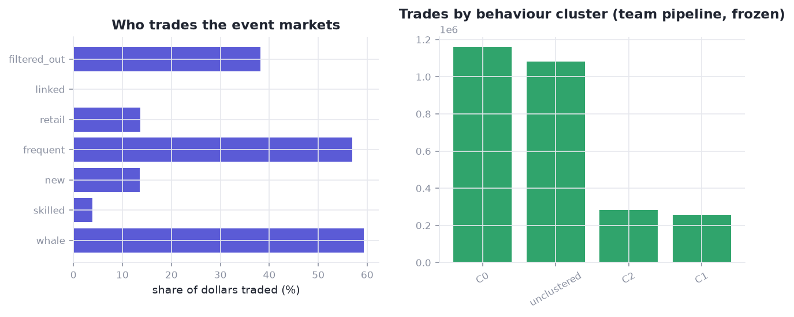

## W0 · Wallet data

**Question.** Is there enough wallet-level data around probability jumps to test W1-W5?

**Verdict: PASS.** 2,777,538 trades by 147,076 wallets in 689 event markets; 1880 probability jumps with trades in the same hour. Team pipeline: 2 same-owner groups, 9878 entities pass the hard rules, 3 behaviour clusters.

| metric | value |
|---|---|
| trades | 2777538 |
| wallets | 147076 |
| markets | 689 |
| market_hours | 1310112 |
| shocks_with_flow | 1880 |
| pipeline.wallets | 74230 |
| pipeline.linked_pairs | 3 |
| pipeline.merged_entities | 2 |
| pipeline.rule_counts.entities | 74227 |
| pipeline.rule_counts.eligible | 9878 |
| pipeline.rule_counts.fewer_than_min_trades | 63207 |
| pipeline.rule_counts.fewer_than_min_active_days | 51898 |
| pipeline.clustering.selected_k | 3 |
| pipeline.clustering.selected_seed | 43 |
| pipeline.clustering.mean_silhouette | 0.1935 |
| pipeline.clustering.seed_stability_ari | 0.9995 |
| pipeline.clustering.size_valid | True |
| pipeline.clustering.minimum_cluster_size | 494 |
| pipeline.clustering.status | fitted |
| pipeline.clustering.removed_features | ['taker_fraction', 'late_activity_fraction'] |
| pipeline.clustering.fit_entities | 9878 |
| pipeline.clustering.cluster_sizes.C0 | 1193 |
| pipeline.clustering.cluster_sizes.C1 | 5076 |
| pipeline.clustering.cluster_sizes.C2 | 3609 |
| cluster_explanations.C0 | higher active days; higher markets traded; higher two sided token fraction |
| cluster_explanations.C1 | higher median gap hours; lower trades per active day; lower busiest day trade fraction |
| cluster_explanations.C2 | higher busiest day trade fraction; higher trades per active day; higher top market notional fraction |

Tables: [clusters](tables/clusters.csv), [pipeline_wallets](tables/pipeline_wallets.csv), [type_shares](tables/type_shares.csv)

- Pass rule: ≥ 100 markets with trades and ≥ 300 jumps with same-hour trades.
- Behaviour clusters are fitted on trades before the median market close and then frozen (team pipeline).
- Types are not exclusive except retail; trade shares: whale 7.0%, skilled 3.9%, new 15.7%, frequent 47.4%, retail 32.8%, linked 0.0%, filtered_out 39.0%.
