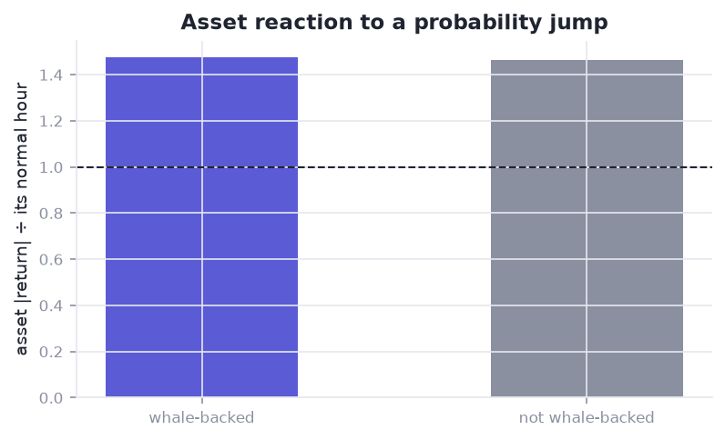

## W1 · Large-wallet confirmation

**Question.** When a jump is pushed by trades of ≥ $5,000 in its direction, do the related assets move more?

**Verdict: FAIL.** Related assets react +0.01× (of a normal hour) more when large wallets back the jump (95% CI -0.28 to +0.36; 822 vs 2548 jump-asset pairs, 308 markets). Same-owner groups backing it: +nan× (CI +nan to +nan).

| metric | value |
|---|---|
| whale_backed.diff | 0.008857 |
| whale_backed.low | -0.2787 |
| whale_backed.high | 0.3607 |
| whale_backed.mean_high_group | 1.474 |
| whale_backed.mean_low_group | 1.465 |
| whale_backed.n_high | 822 |
| whale_backed.n_low | 2548 |
| whale_backed.markets | 308 |
| same_owner_group_backed.diff | n/a |
| same_owner_group_backed.low | n/a |
| same_owner_group_backed.high | n/a |
| same_owner_group_backed.n_high | 0 |
| same_owner_group_backed.n_low | 3370 |
| same_owner_group_backed.markets | 308 |

- Pass rule (pre-registered): whale-backed minus other jumps > 0, 95% CI above 0, resampling markets.
- Same-owner groups come from the team's sniper grouping; reported as secondary.
