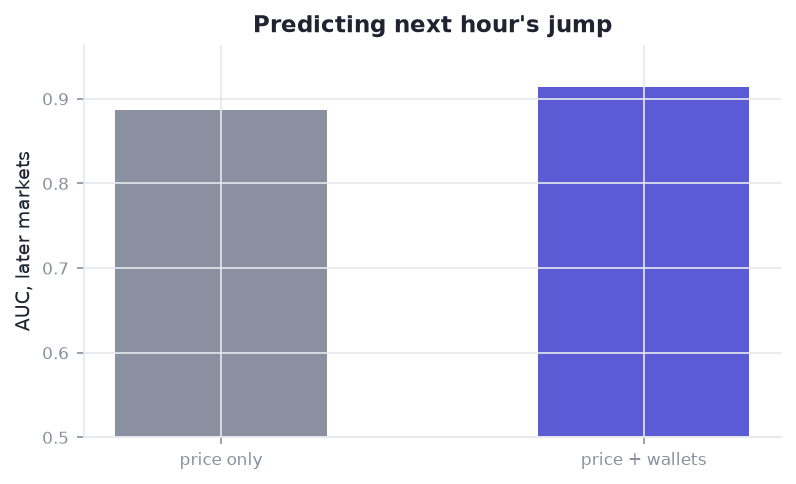

## W3 · Early warning

**Question.** Does unusual wallet activity this hour warn of a probability jump next hour, beyond recent price moves?

**Verdict: PASS.** Out of time, adding wallet activity moves the AUC from 0.887 to 0.914 (gain +0.027, 95% CI +0.018 to +0.038); the 5% most unusual hours are followed by a jump 12.8× as often as average.

| metric | value |
|---|---|
| auc_price_only | 0.8866 |
| auc_with_wallets | 0.9139 |
| gain | 0.02733 |
| low | 0.01796 |
| high | 0.03829 |
| top5pct_lift | 12.82 |
| coefficients.intercept | -7.237 |
| coefficients.abs_dp | 0.1342 |
| coefficients.recent_vol | 0.3695 |
| coefficients.gross_z | 0.0756 |
| coefficients.whale_z | -0.0814 |
| coefficients.wallets_z | 0.8544 |
| coefficients.new_z | 0.008 |
| coefficients.imbalance | -0.1464 |
| train_hours | 699265 |
| test_hours | 602579 |
| test_jumps | 1718 |

- Trained on earlier-closing markets, tested on later-closing ones.
- Pass rule (pre-registered): AUC gain over the price-only model > 0 with the 95% CI above 0 (markets resampled).
