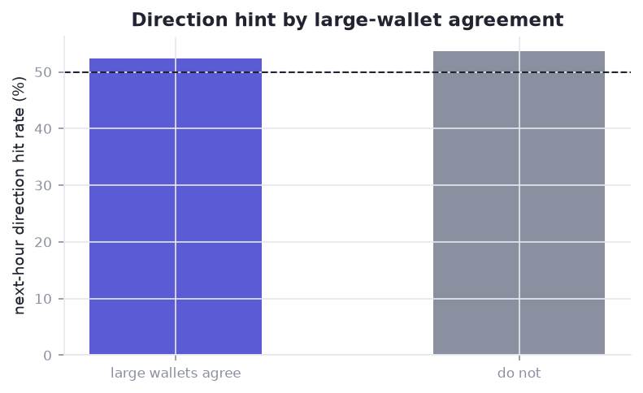

## W4 · Large wallets and the direction hint

**Question.** Does V2's next-hour direction hint work better when large wallets push the jump?

**Verdict: FAIL.** Direction hint hit rate 52.3% when large wallets agree vs 53.6% otherwise (difference -1.3 points, 95% CI -6.2 to +3.2; 805 vs 2334).

| metric | value |
|---|---|
| agree_vs_not.diff | -0.01301 |
| agree_vs_not.low | -0.06175 |
| agree_vs_not.high | 0.03193 |
| agree_vs_not.mean_high_group | 0.523 |
| agree_vs_not.mean_low_group | 0.536 |
| agree_vs_not.n_high | 805 |
| agree_vs_not.n_low | 2334 |
| agree_vs_not.markets | 291 |
| agree_hit_rate_minus_half.mean | 0.02298 |
| agree_hit_rate_minus_half.low | -0.01824 |
| agree_hit_rate_minus_half.high | 0.06155 |
| agree_hit_rate_minus_half.n | 805 |
| agree_hit_rate_minus_half.groups | 135 |
| agree_hit_rate_minus_half.p_two_sided | 0.2545 |

- Pass rule (pre-registered): agree minus not-agree hit rate > 0 with the 95% CI above 0 (markets resampled).
