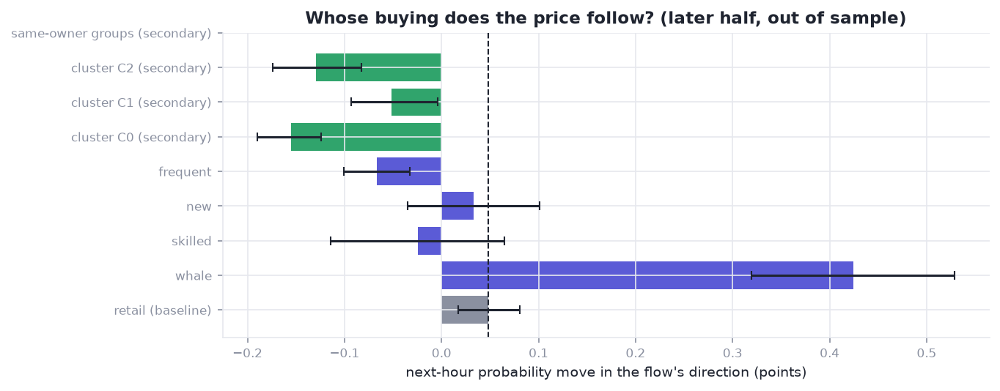

## W5 · Whose buying leads?

**Question.** Is there a wallet type (or behaviour cluster) whose buying the probability follows more than retail's?

**Verdict: PASS.** After retail buying the price follows +0.05 points next hour. Beating that (Bonferroni CI above retail): whale +0.42.

| metric | value |
|---|---|
| by_type | [{'type': 'retail (baseline)', 'mean': 0.0004836724935660343, 'low': 0.00017516484229197963, 'high': 0.0008058478509032093, 'n': 71107, 'groups': 339, 'p_two_sided': 0.003}, {'type': 'whale', 'mean': 0.004242106280193237, 'low': 0.003194868097455796, 'high': 0.005289344462930679, 'n': 25875, 'groups': 313, 'p_two_sided': 0.0}, {'type': 'skilled', 'mean': -0.0002443303061882784, 'low': -0.0011391460980844273, 'high': 0.0006504854857078703, 'n': 20151, 'groups': 312, 'p_two_sided': 0.4535}, {'type': 'new', 'mean': 0.00033053262578616353, 'low': -0.0003509222249558737, 'high': 0.0010119874765282008, 'n': 30528, 'groups': 333, 'p_two_sided': 0.1965}, {'type': 'frequent', 'mean': -0.0006680820725074767, 'low': -0.0010103664787457147, 'high': -0.0003257976662692386, 'n': 79247, 'groups': 332, 'p_two_sided': 0.0}, {'type': 'cluster C0 (secondary)', 'mean': -0.0015511181856865926, 'low': -0.0018977799409839178, 'high': -0.0012393793123346307, 'n': 63451, 'groups': 319, 'p_two_sided': 0.0}, {'type': 'cluster C1 (secondary)', 'mean': -0.0005150427637095422, 'low': -0.00093065730621008, 'high': -3.89800133677262e-05, 'n': 29815, 'groups': 324, 'p_two_sided': 0.0245}, {'type': 'cluster C2 (secondary)', 'mean': -0.00129765054503122, 'low': -0.001737352281307513, 'high': -0.0008258229132914362, 'n': 28347, 'groups': 322, 'p_two_sided': 0.0}, {'type': 'same-owner groups (secondary)', 'mean': nan, 'low': nan, 'high': nan, 'n': 0, 'groups': 0, 'p_two_sided': nan}] |
| regression_points.intercept | 0.009 |
| regression_points.f_retail | 0.035 |
| regression_points.f_whale | 0.463 |
| regression_points.f_skilled | -0.028 |
| regression_points.f_new | 0.004 |
| regression_points.f_frequent | -0.108 |
| cluster_explanations.C0 | higher active days; higher markets traded; higher two sided token fraction |
| cluster_explanations.C1 | higher median gap hours; lower trades per active day; lower busiest day trade fraction |
| cluster_explanations.C2 | higher busiest day trade fraction; higher trades per active day; higher top market notional fraction |

Tables: [by_type](tables/by_type.csv)

- Tested on the later half of the data only, since the behaviour clusters are fitted on the earlier half.
- Pass rule (pre-registered): a main type (whale, skilled, new, frequent) whose 98.75% CI lies above retail's mean. Behaviour clusters and same-owner groups (team pipeline) are reported as secondary.
