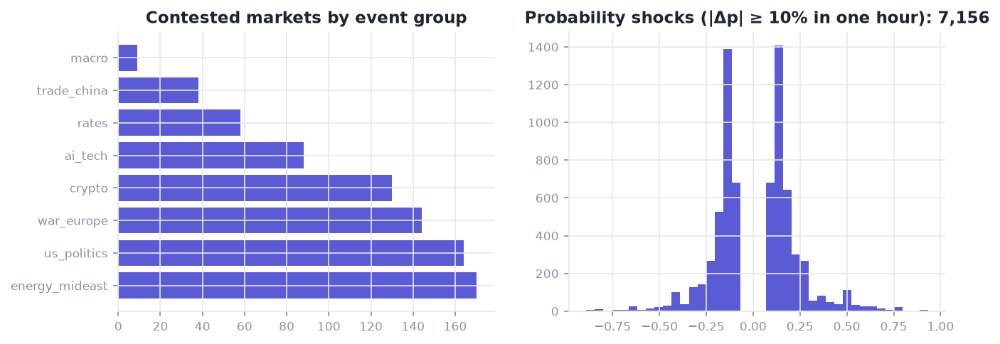
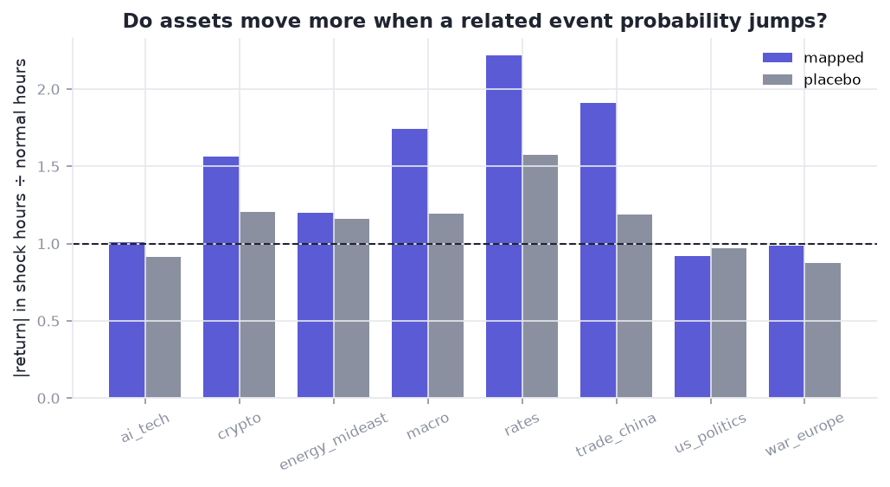
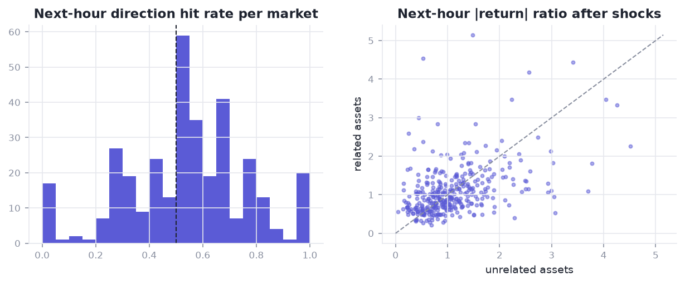
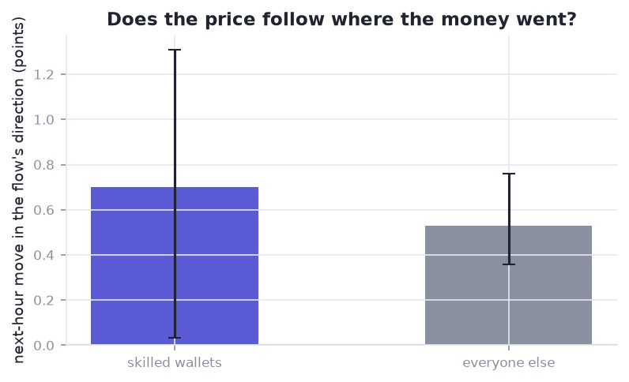
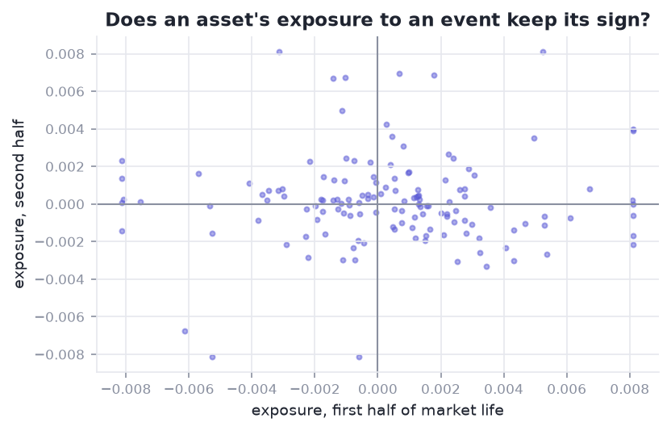

# T2 · Event-probability shocks and the assets they move

Run `20261127-014406_events` on dataset **events**.

| Experiment | Verdict | Headline |
|---|---|---|
| [V0 Data](v0/summary.md) | **pass** | 689 event markets aligned with hourly prices of 26 assets; 7,156 shock hours. |
| [V1 Same-hour sensitivity](v1/summary.md) | **pass** | In shock hours, related assets move +0.25× (of normal-hour size) more than unrelated assets (95% CI +0.15 to +0.34, 366 markets). Without crypto-price markets: +0.22× (CI +0.11 to +0.34). |
| [V2 Next-hour lead](v2/summary.md) | **pass** | Next-hour direction after shocks: hit rate 53.1% (95% CI 50.6% to 55.5%, 343 markets). Next-hour size effect vs unrelated assets: -0.01× (CI -0.08 to +0.06). |
| [V3 Skilled wallets lead the probability](v3/summary.md) | **pass** | After an hour of net skilled-wallet buying (≥ $500), the probability moves +0.70 points their way next hour (95% CI +0.03 to +1.31, 170 markets); everyone else: +0.53. |
| [V4 Stable exposures](v4/summary.md) | **fail** | Exposure keeps its sign in 44% of related market-asset pairs (95% CI 34% to 54%, 42 markets). |
| [V5 Robustness of V2 and V3](v5/summary.md) | **pass** | V2 direction holds: placebo assets 50.5% (≈ 50% as it should be), related assets without crypto-price markets 53.4%. V3: skilled minus other wallets' flow = -3.40 points per market (CI -5.99 to -1.32), so skilled wallets do not move first beyond ordinary order-flow momentum. |

**Decision (pre-registered rule):** T2 works as a risk tool: Polymarket shocks move the assets they relate to (event exposure monitor). Shocks also lean on the next hour's direction (weak; see V5): show it as a hint, not a signal. Prices keep moving with net wallet flow; whether *skilled* wallets add to that is checked in V5.

## V0 · Data

**Question.** Are there enough contested event markets overlapping with asset trading hours?

**Verdict: PASS.** 689 event markets aligned with hourly prices of 26 assets; 7,156 shock hours.

| metric | value |
|---|---|
| markets | 689 |
| markets_with_aligned_assets | 689 |
| pairs | 4345 |
| shock_hours | 7156 |
| asset_series | 26 |

Tables: [groups](v0/tables/groups.csv)

- Pass rule: ≥ 100 markets with aligned mapped assets.

## V1 · Same-hour sensitivity

**Question.** When an event's probability jumps, do the assets linked to that event move more than unrelated assets?

**Verdict: PASS.** In shock hours, related assets move +0.25× (of normal-hour size) more than unrelated assets (95% CI +0.15 to +0.34, 366 markets). Without crypto-price markets: +0.22× (CI +0.11 to +0.34).

| metric | value |
|---|---|
| main.mean | 0.2471 |
| main.low | 0.1482 |
| main.high | 0.3435 |
| main.n | 366 |
| main.groups | 366 |
| main.p_two_sided | 0 |
| without_crypto_price_markets.mean | 0.2162 |
| without_crypto_price_markets.low | 0.1063 |
| without_crypto_price_markets.high | 0.3363 |
| without_crypto_price_markets.n | 288 |
| without_crypto_price_markets.groups | 288 |
| without_crypto_price_markets.p_two_sided | 0 |
| crypto_price_markets_only.mean | 0.361 |
| crypto_price_markets_only.low | 0.1936 |
| crypto_price_markets_only.high | 0.5386 |
| crypto_price_markets_only.n | 78 |
| crypto_price_markets_only.groups | 78 |
| crypto_price_markets_only.p_two_sided | 0 |

Tables: [by_group](v1/tables/by_group.csv), [per_market](v1/tables/per_market.csv)

- Direction-free test (a market's YES can be good or bad news for an asset).
- Pass rule: mapped-minus-placebo ratio > 0 with the 95% CI above 0 (bootstrap over markets); fewer than 30 markets = inconclusive.

## V2 · Next-hour lead

**Question.** Does a probability shock tell us where the related asset goes in the following hour?

**Verdict: PASS.** Next-hour direction after shocks: hit rate 53.1% (95% CI 50.6% to 55.5%, 343 markets). Next-hour size effect vs unrelated assets: -0.01× (CI -0.08 to +0.06).

| metric | value |
|---|---|
| direction.mean | 0.03149 |
| direction.low | 0.006092 |
| direction.high | 0.05468 |
| direction.n | 343 |
| direction.groups | 343 |
| direction.p_two_sided | 0.014 |
| next_hour_size.mean | -0.008494 |
| next_hour_size.low | -0.08053 |
| next_hour_size.high | 0.06371 |
| next_hour_size.n | 366 |
| next_hour_size.groups | 366 |
| next_hour_size.p_two_sided | 0.8205 |

Tables: [per_market_hits](v2/tables/per_market_hits.csv)

- Direction uses the sign of each market-asset co-movement estimated on earlier hours only.
- Pass rule (direction): hit rate above 50% with the 95% CI above 50%; < 30 markets = inconclusive. The size effect is reported as secondary (useful for a volatility warning).

## V3 · Skilled wallets lead the probability

**Question.** Does net buying by skilled wallets predict the next hour's probability move?

**Verdict: PASS.** After an hour of net skilled-wallet buying (≥ $500), the probability moves +0.70 points their way next hour (95% CI +0.03 to +1.31, 170 markets); everyone else: +0.53.

| metric | value |
|---|---|
| top_flow.mean | 0.007012 |
| top_flow.low | 0.000344 |
| top_flow.high | 0.01307 |
| top_flow.n | 1091 |
| top_flow.groups | 170 |
| top_flow.p_two_sided | 0.0345 |
| rest_flow.mean | 0.00528 |
| rest_flow.low | 0.003582 |
| rest_flow.high | 0.007582 |
| rest_flow.n | 11458 |
| rest_flow.groups | 298 |
| rest_flow.p_two_sided | 0 |

- Skill is point-in-time (topic F's timeline: markets closed before each trade).
- Pass rule: skilled-flow signed next-hour move > 0 with the 95% CI above 0; < 30 markets = inconclusive.

## V4 · Stable exposures

**Question.** If an asset rose with an event's probability early on, does it still do so later?

**Verdict: FAIL.** Exposure keeps its sign in 44% of related market-asset pairs (95% CI 34% to 54%, 42 markets).

| metric | value |
|---|---|
| main.mean | -0.06115 |
| main.low | -0.1613 |
| main.high | 0.04033 |
| main.n | 139 |
| main.groups | 42 |
| main.p_two_sided | 0.242 |
| pairs | 139 |

Tables: [pairs](v4/tables/pairs.csv)

- Exposure = slope of hourly asset return on hourly change in the event's log-odds.
- Pass rule: sign agreement above 50% with the 95% CI above 50%.

## V5 · Robustness of V2 and V3

**Question.** Do the narrow V2/V3 passes survive placebo, subgroup and head-to-head checks?

**Verdict: PASS.** V2 direction holds: placebo assets 50.5% (≈ 50% as it should be), related assets without crypto-price markets 53.4%. V3: skilled minus other wallets' flow = -3.40 points per market (CI -5.99 to -1.32), so skilled wallets do not move first beyond ordinary order-flow momentum.

| metric | value |
|---|---|
| direction_mapped.hit_rate | 0.5315 |
| direction_mapped.low | 0.5061 |
| direction_mapped.high | 0.5547 |
| direction_mapped.markets | 343 |
| direction_placebo.hit_rate | 0.5052 |
| direction_placebo.low | 0.4768 |
| direction_placebo.high | 0.5331 |
| direction_placebo.markets | 363 |
| direction_mapped_without_crypto.hit_rate | 0.534 |
| direction_mapped_without_crypto.low | 0.5064 |
| direction_mapped_without_crypto.high | 0.5624 |
| direction_mapped_without_crypto.markets | 256 |
| wallets.per_market_top_minus_rest.mean | -0.03401 |
| wallets.per_market_top_minus_rest.low | -0.05993 |
| wallets.per_market_top_minus_rest.high | -0.01316 |
| wallets.per_market_top_minus_rest.n | 170 |
| wallets.per_market_top_minus_rest.groups | 170 |
| wallets.per_market_top_minus_rest.p_two_sided | 0.0085 |
| wallets.markets | 170 |
| wallets.regression_points.skilled_flow | 0.007896 |
| wallets.regression_points.other_flow | 0.006247 |
| wallets.regression_points.hours | 11693 |
| v2_holds | True |
| skilled_beat_others | False |

Tables: [direction_by_group](v5/tables/direction_by_group.csv)

- Added after V2 and V3 passed narrowly; reported as a robustness check, not a new pass rule.
- Verdict reflects V2 only; the wallet head-to-head is reported in the metrics and headline.
