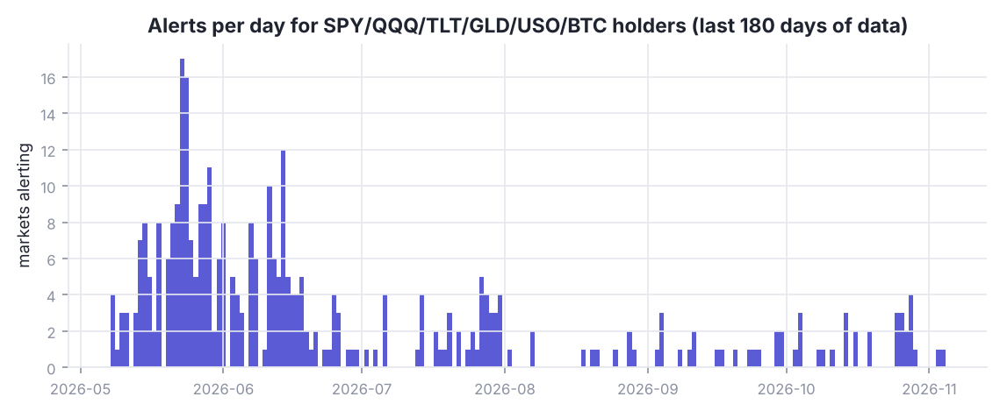

## D3 · Alert value and load

**Question.** Does an alert carry information, and would a daily user get a usable number of them?

**Verdict: PASS.** An alert is followed by a big move (top 20% of the asset's hours) 24% of the time for related assets vs 17% for unrelated ones (difference +7.0 points, CI +4.3 to +9.6). Reference portfolio: at least one alert on 56% of days, median 1/day, 95th percentile 8/day.

| metric | value |
|---|---|
| checks.a_alert_value | True |
| checks.b_load_some_days | True |
| checks.b_load_not_spam | True |
| value.mean | 0.07021 |
| value.low | 0.04255 |
| value.high | 0.09626 |
| value.n | 350 |
| value.groups | 350 |
| value.p_two_sided | 0 |
| mapped_big_rate | 0.2423 |
| placebo_big_rate | 0.1721 |
| share_days_with_alert | 0.558 |
| median_per_day | 1 |
| p95_per_day | 8 |
| mean_watched_markets_per_day | 29.31 |
| window | ['2026-05-08', '2026-11-04'] |

Tables: [alerts_per_day](tables/alerts_per_day.csv)

- Counts are a lower bound: only a sample of markets was collected (limitation L5).
- Pass rule (pre-registered): big-move rate mapped − placebo CI > 0; >= 1 alert on >= 50% of days; 95th percentile <= 30 alerts/day.
