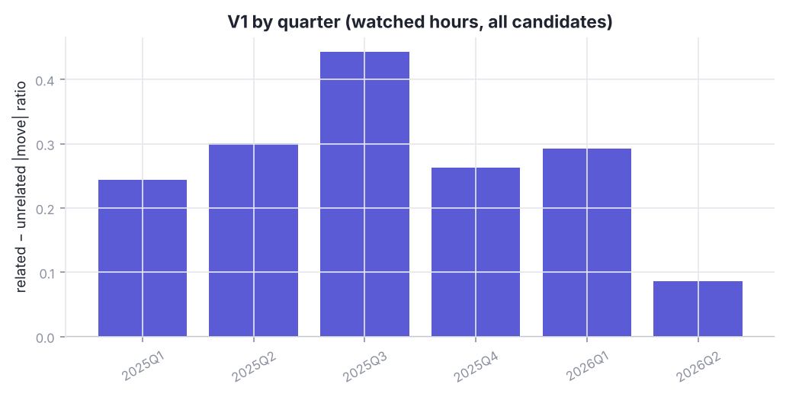
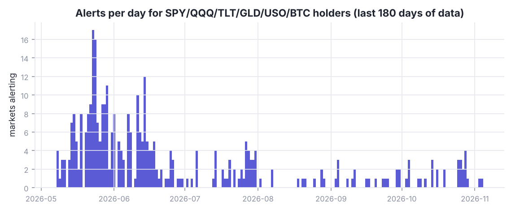

# T2-D · Daily-use applicability (docs/05)

Run `20261127-0230_daily_events` on dataset **events**.

| Experiment | Verdict | Headline |
|---|---|---|
| [D1 Point-in-time universe](d1/summary.md) | **pass** | Without the hindsight filter (350 markets, watch rule): V1 +0.22× (CI +0.13 to +0.32); W3 AUC gain +0.040 (CI +0.027 to +0.055); W5 whale +0.84 (CI low +0.66) vs retail +0.09 points. |
| [D2 Stability over time](d2/summary.md) | **pass** | V1 positive in 6 of 6 quarters (latest 2026Q2: +0.09×); W3 rolling gain positive in 8 of 8 quarters, pooled +0.049 (CI +0.040 to +0.060); W5 whale beats retail in 8 of 8 quarters. |
| [D3 Alert value and load](d3/summary.md) | **pass** | An alert is followed by a big move (top 20% of the asset's hours) 24% of the time for related assets vs 17% for unrelated ones (difference +7.0 points, CI +4.3 to +9.6). Reference portfolio: at least one alert on 56% of days, median 1/day, 95th percentile 8/day. |
| [D4 Live feasibility](d4/summary.md) | **pass** | 20261127-021157_live_check: refresh 21.1 s for 50 watched markets; median latest-trade age 19.1 min; BTC bar age -1.1 min; sources {'gamma': True, 'data_api': True, 'clob': True, 'yahoo': True}. |
| [D5 Daily resolution](d5/summary.md) | **pass** | Day level: on days a related market moves ≥ 10 points, related assets' daily move exceeds unrelated by +0.23× (CI +0.16 to +0.29, 412 markets); without crypto-price markets +0.10× (CI +0.04 to +0.16). |
| [D6 Generality across event types](d6/summary.md) | **pass** | Positive in 6 of 7 event groups (ai_tech +0.12, crypto +0.33, energy_mideast +0.18, rates +0.48, trade_china +0.52, us_politics -0.18, war_europe +0.13); leaving out any one group, the smallest lower CI is +0.10. |

**Decision (pre-registered rule):** All required daily-use gates pass: build prototype v1 with a daily digest.

## D1 · Point-in-time universe

**Question.** Do the passed findings hold on every market the app could see at the time, not only hindsight-chosen ones?

**Verdict: PASS.** Without the hindsight filter (350 markets, watch rule): V1 +0.22× (CI +0.13 to +0.32); W3 AUC gain +0.040 (CI +0.027 to +0.055); W5 whale +0.84 (CI low +0.66) vs retail +0.09 points.

| metric | value |
|---|---|
| checks.a_v1_all_candidates | True |
| checks.b_w3_gain | True |
| checks.c_w5_whale_above_retail | True |
| v1.mean | 0.2216 |
| v1.low | 0.1301 |
| v1.high | 0.3163 |
| v1.n | 350 |
| v1.groups | 350 |
| v1.p_two_sided | 0 |
| v1_slices | [{'slice': 'all candidates (watched)', 'mean': 0.22163558132076677, 'low': 0.13012046098018995, 'high': 0.3162913846904996, 'n': 350, 'groups': 350, 'p_two_sided': 0.0}, {'slice': 'research markets only', 'mean': 0.22388279521559584, 'low': 0.13207055309177132, 'high': 0.3162821993095486, 'n': 342, 'groups': 342, 'p_two_sided': 0.0}, {'slice': 'markets the hindsight filter dropped', 'mean': 0.12556718731682265, 'low': -0.15828152830487818, 'high': 0.395288933226896, 'n': 8, 'groups': 8, 'p_two_sided': 0.38}, {'slice': 'lowest-volume third', 'mean': 0.23738651730044033, 'low': 0.11253358954872121, 'high': 0.3815413204036229, 'n': 113, 'groups': 113, 'p_two_sided': 0.001}] |
| w3.auc_price_only | 0.8676 |
| w3.auc_with_wallets | 0.9074 |
| w3.gain | 0.03978 |
| w3.low | 0.02701 |
| w3.high | 0.05465 |
| w3.top5pct_lift | 12.47 |
| w3.coefficients.intercept | -6.917 |
| w3.coefficients.abs_dp | 0.1252 |
| w3.coefficients.recent_vol | 0.4013 |
| w3.coefficients.gross_z | 0.0172 |
| w3.coefficients.whale_z | -0.0599 |
| w3.coefficients.wallets_z | 0.8674 |
| w3.coefficients.new_z | 0.0075 |
| w3.coefficients.imbalance | -0.0413 |
| w3.train_hours | 448843 |
| w3.test_hours | 380102 |
| w3.test_jumps | 1468 |
| w5_whale.mean | 0.008367 |
| w5_whale.low | 0.006616 |
| w5_whale.high | 0.01012 |
| w5_whale.n | 12747 |
| w5_whale.groups | 276 |
| w5_whale.p_two_sided | 0 |
| w5_retail.mean | 0.0009363 |
| w5_retail.low | 0.0004845 |
| w5_retail.high | 0.001436 |
| w5_retail.n | 42689 |
| w5_retail.groups | 316 |
| w5_retail.p_two_sided | 0.0005 |
| watched_wallet_hours | 837213 |
| low_volume_cut_usd | 2.923e+06 |

Tables: [v1_slices](d1/tables/v1_slices.csv)

- Watch rule: >= 24 h of history and probability 1 h earlier in 10-90%.
- Pass rule (pre-registered): (a) V1 CI > 0 on all candidates, (b) W3 gain CI > 0, (c) W5 whale CI above retail.

## D2 · Stability over time

**Question.** Do the effects keep holding quarter by quarter, including the most recent quarter?

**Verdict: PASS.** V1 positive in 6 of 6 quarters (latest 2026Q2: +0.09×); W3 rolling gain positive in 8 of 8 quarters, pooled +0.049 (CI +0.040 to +0.060); W5 whale beats retail in 8 of 8 quarters.

| metric | value |
|---|---|
| checks.a_v1_quarters | True |
| checks.b_w3_rolling | True |
| checks.c_w5_quarters | True |
| w3_pooled.gain | 0.0491 |
| w3_pooled.low | 0.03952 |
| w3_pooled.high | 0.06049 |
| v1_quarters | [{'quarter': '2024Q4', 'mean': 0.1606286732527431, 'markets': 8}, {'quarter': '2025Q1', 'mean': 0.24417374744584408, 'markets': 51}, {'quarter': '2025Q2', 'mean': 0.3007339154224479, 'markets': 48}, {'quarter': '2025Q3', 'mean': 0.44344318899521823, 'markets': 50}, {'quarter': '2025Q4', 'mean': 0.2633948559424976, 'markets': 67}, {'quarter': '2026Q1', 'mean': 0.29193318396615703, 'markets': 64}, {'quarter': '2026Q2', 'mean': 0.08583281254965368, 'markets': 77}, {'quarter': '2026Q3', 'mean': 0.3684590314475568, 'markets': 15}, {'quarter': '2026Q4', 'mean': -0.15175675835641805, 'markets': 5}] |
| w3_quarters | [{'quarter': '2025Q1', 'auc_price_only': 0.8819754742821888, 'auc_with_wallets': 0.9428675652120588, 'gain': 0.060892090929870024, 'test_hours': 87105, 'jumps': 310}, {'quarter': '2025Q2', 'auc_price_only': 0.8861676444644648, 'auc_with_wallets': 0.9316642259174079, 'gain': 0.04549658145294311, 'test_hours': 95553, 'jumps': 367}, {'quarter': '2025Q3', 'auc_price_only': 0.8906960337068861, 'auc_with_wallets': 0.9548007085978981, 'gain': 0.06410467489101201, 'test_hours': 161979, 'jumps': 264}, {'quarter': '2025Q4', 'auc_price_only': 0.8608237155076455, 'auc_with_wallets': 0.9048800538337858, 'gain': 0.04405633832614031, 'test_hours': 137002, 'jumps': 450}, {'quarter': '2026Q1', 'auc_price_only': 0.8917394310258824, 'auc_with_wallets': 0.935598336119857, 'gain': 0.04385890509397461, 'test_hours': 151531, 'jumps': 430}, {'quarter': '2026Q2', 'auc_price_only': 0.853815218370636, 'auc_with_wallets': 0.8970889805312193, 'gain': 0.04327376216058332, 'test_hours': 118571, 'jumps': 758}, {'quarter': '2026Q3', 'auc_price_only': 0.844941607030467, 'auc_with_wallets': 0.954136460057344, 'gain': 0.10919485302687704, 'test_hours': 42969, 'jumps': 70}, {'quarter': '2026Q4', 'auc_price_only': 0.8534585662043745, 'auc_with_wallets': 0.9347788587594011, 'gain': 0.0813202925550266, 'test_hours': 9692, 'jumps': 30}] |
| w5_quarters | [{'quarter': '2024Q3', 'whale': 0.004500000000000004, 'whale_markets': 1, 'retail': -0.006111111111111117, 'retail_markets': 1, 'diff': 0.01061111111111112}, {'quarter': '2024Q4', 'whale': 0.009213483146067415, 'whale_markets': 22, 'retail': -0.0013490566037735845, 'retail_markets': 34, 'diff': 0.010562539749841}, {'quarter': '2025Q1', 'whale': 0.010533538025507794, 'whale_markets': 91, 'retail': 0.001468922987277848, 'retail_markets': 107, 'diff': 0.009064615038229947}, {'quarter': '2025Q2', 'whale': 0.00853125, 'whale_markets': 97, 'retail': 0.0021856185324553154, 'retail_markets': 112, 'diff': 0.006345631467544685}, {'quarter': '2025Q3', 'whale': 0.009994615384615385, 'whale_markets': 100, 'retail': 0.0032652085124677556, 'retail_markets': 137, 'diff': 0.006729406872147629}, {'quarter': '2025Q4', 'whale': 0.008904377880184331, 'whale_markets': 120, 'retail': 0.0018399805447470818, 'retail_markets': 158, 'diff': 0.007064397335437249}, {'quarter': '2026Q1', 'whale': 0.007623360655737705, 'whale_markets': 143, 'retail': 0.0014201312910284466, 'retail_markets': 183, 'diff': 0.006203229364709258}, {'quarter': '2026Q2', 'whale': 0.009922535211267606, 'whale_markets': 151, 'retail': 0.0009996418338108883, 'retail_markets': 177, 'diff': 0.008922893377456716}, {'quarter': '2026Q3', 'whale': 0.0071718905472636825, 'whale_markets': 40, 'retail': 6.5595716198126e-05, 'retail_markets': 44, 'diff': 0.007106294831065557}, {'quarter': '2026Q4', 'whale': 0.002364321608040201, 'whale_markets': 17, 'retail': -0.0010826226012793168, 'retail_markets': 20, 'diff': 0.003446944209319518}] |

Tables: [v1_quarters](d2/tables/v1_quarters.csv), [w3_quarters](d2/tables/w3_quarters.csv), [w5_quarters](d2/tables/w5_quarters.csv)

- W3 is rolling-origin: each quarter is scored by a model trained only on hours before it.
- Pass rule (pre-registered): V1 > 0 in >= 2/3 of quarters with >= 20 markets and in the latest; W3 gain > 0 in >= 2/3 of quarters and pooled CI > 0; W5 whale > retail in >= 2/3 of quarters.

## D3 · Alert value and load

**Question.** Does an alert carry information, and would a daily user get a usable number of them?

**Verdict: PASS.** An alert is followed by a big move (top 20% of the asset's hours) 24% of the time for related assets vs 17% for unrelated ones (difference +7.0 points, CI +4.3 to +9.6). Reference portfolio: at least one alert on 56% of days, median 1/day, 95th percentile 8/day.

| metric | value |
|---|---|
| checks.a_alert_value | True |
| checks.b_load_some_days | True |
| checks.b_load_not_spam | True |
| value.mean | 0.07021 |
| value.low | 0.04255 |
| value.high | 0.09626 |
| value.n | 350 |
| value.groups | 350 |
| value.p_two_sided | 0 |
| mapped_big_rate | 0.2423 |
| placebo_big_rate | 0.1721 |
| share_days_with_alert | 0.558 |
| median_per_day | 1 |
| p95_per_day | 8 |
| mean_watched_markets_per_day | 29.31 |
| window | ['2026-05-08', '2026-11-04'] |

Tables: [alerts_per_day](d3/tables/alerts_per_day.csv)

- Counts are a lower bound: only a sample of markets was collected (limitation L5).
- Pass rule (pre-registered): big-move rate mapped − placebo CI > 0; >= 1 alert on >= 50% of days; 95th percentile <= 30 alerts/day.

## D4 · Live feasibility

**Question.** Can the app get the live data it needs, fresh and fast enough?

**Verdict: PASS.** 20261127-021157_live_check: refresh 21.1 s for 50 watched markets; median latest-trade age 19.1 min; BTC bar age -1.1 min; sources {'gamma': True, 'data_api': True, 'clob': True, 'yahoo': True}.

| metric | value |
|---|---|
| id | d4 |
| verdict | pass |
| run_at | 2026-11-26T18:12:18.116135+00:00 |
| reachable.gamma | True |
| reachable.data_api | True |
| reachable.clob | True |
| reachable.yahoo | True |
| checks.all_sources_reachable | True |
| checks.median_trade_age_ok | True |
| checks.btc_bar_fresh | True |
| checks.refresh_fast | True |
| refresh_seconds | 21.1 |
| markets_scanned | 500 |
| watched_markets | 50 |
| median_trade_age_min | 19.12 |
| markets_with_trade_last_hour | 45 |
| btc_bar_age_min | -1.143 |

- Pass rule (pre-registered): all sources reachable; median trade age <= 60 min; BTC bar <= 90 min; refresh <= 120 s.

## D5 · Daily resolution

**Question.** Is a once-a-day summary still informative?

**Verdict: PASS.** Day level: on days a related market moves ≥ 10 points, related assets' daily move exceeds unrelated by +0.23× (CI +0.16 to +0.29, 412 markets); without crypto-price markets +0.10× (CI +0.04 to +0.16).

| metric | value |
|---|---|
| main.mean | 0.2262 |
| main.low | 0.1626 |
| main.high | 0.295 |
| main.n | 412 |
| main.groups | 412 |
| main.p_two_sided | 0 |
| without_crypto_price_markets.mean | 0.1018 |
| without_crypto_price_markets.low | 0.03775 |
| without_crypto_price_markets.high | 0.1631 |
| without_crypto_price_markets.n | 339 |
| without_crypto_price_markets.groups | 339 |
| without_crypto_price_markets.p_two_sided | 0.001 |

- Probability sampled at each asset's daily close (16:00 ET stocks, 00:00 UTC crypto).
- Pass rule: CI > 0. Not required to build; decides the daily digest.

## D6 · Generality across event types

**Question.** Does the effect hold across event types, not only one group?

**Verdict: PASS.** Positive in 6 of 7 event groups (ai_tech +0.12, crypto +0.33, energy_mideast +0.18, rates +0.48, trade_china +0.52, us_politics -0.18, war_europe +0.13); leaving out any one group, the smallest lower CI is +0.10.

| metric | value |
|---|---|
| checks.half_of_groups_positive | True |
| checks.no_group_drives_it | True |
| by_group | [{'group': 'ai_tech', 'mean': 0.12300282359389826, 'low': -0.015031209014806498, 'high': 0.24992406533543965, 'n': 44, 'groups': 44, 'p_two_sided': 0.07}, {'group': 'crypto', 'mean': 0.3281270402651575, 'low': 0.13458135269003113, 'high': 0.5248940620361094, 'n': 69, 'groups': 69, 'p_two_sided': 0.0}, {'group': 'energy_mideast', 'mean': 0.18073400693847314, 'low': 0.025539059334790084, 'high': 0.33420671106855937, 'n': 87, 'groups': 87, 'p_two_sided': 0.0195}, {'group': 'rates', 'mean': 0.48283988521893934, 'low': -0.03471704891048922, 'high': 1.0029259216427013, 'n': 33, 'groups': 33, 'p_two_sided': 0.071}, {'group': 'trade_china', 'mean': 0.518753890988436, 'low': 0.11566621410389064, 'high': 1.024731952998463, 'n': 27, 'groups': 27, 'p_two_sided': 0.027}, {'group': 'us_politics', 'mean': -0.18252700458848395, 'low': -0.3929872259865685, 'high': 0.0253265074812644, 'n': 33, 'groups': 33, 'p_two_sided': 0.088}, {'group': 'war_europe', 'mean': 0.12965396082303282, 'low': 0.01618241111249414, 'high': 0.24933888689735237, 'n': 53, 'groups': 53, 'p_two_sided': 0.0315}] |
| leave_one_out | [{'left_out': 'ai_tech', 'mean': 0.23581806935992433, 'low': 0.13599825379040809, 'high': 0.3347768050615769, 'n': 306, 'groups': 306, 'p_two_sided': 0.0}, {'left_out': 'crypto', 'mean': 0.19548643303904803, 'low': 0.09689146946232917, 'high': 0.29824664036905835, 'n': 281, 'groups': 281, 'p_two_sided': 0.0}, {'left_out': 'energy_mideast', 'mean': 0.23516575991871178, 'low': 0.12616274815382303, 'high': 0.3504216480234532, 'n': 263, 'groups': 263, 'p_two_sided': 0.0}, {'left_out': 'rates', 'mean': 0.19444396608846487, 'low': 0.10922384901184971, 'high': 0.27639199394753255, 'n': 317, 'groups': 317, 'p_two_sided': 0.0}, {'left_out': 'trade_china', 'mean': 0.19679906627114735, 'low': 0.10962551512982106, 'high': 0.28899630938902376, 'n': 323, 'groups': 323, 'p_two_sided': 0.0}, {'left_out': 'us_politics', 'mean': 0.26370928900217144, 'low': 0.16480788322314208, 'high': 0.36377067091596094, 'n': 317, 'groups': 317, 'p_two_sided': 0.0}, {'left_out': 'war_europe', 'mean': 0.23804980989443647, 'low': 0.13500193103754482, 'high': 0.3493812954506885, 'n': 297, 'groups': 297, 'p_two_sided': 0.0}] |

Tables: [by_group](d6/tables/by_group.csv), [leave_one_out](d6/tables/leave_one_out.csv)

- Pass rule (pre-registered): > 0 in >= half of groups with >= 10 markets; every leave-one-group-out CI > 0.
