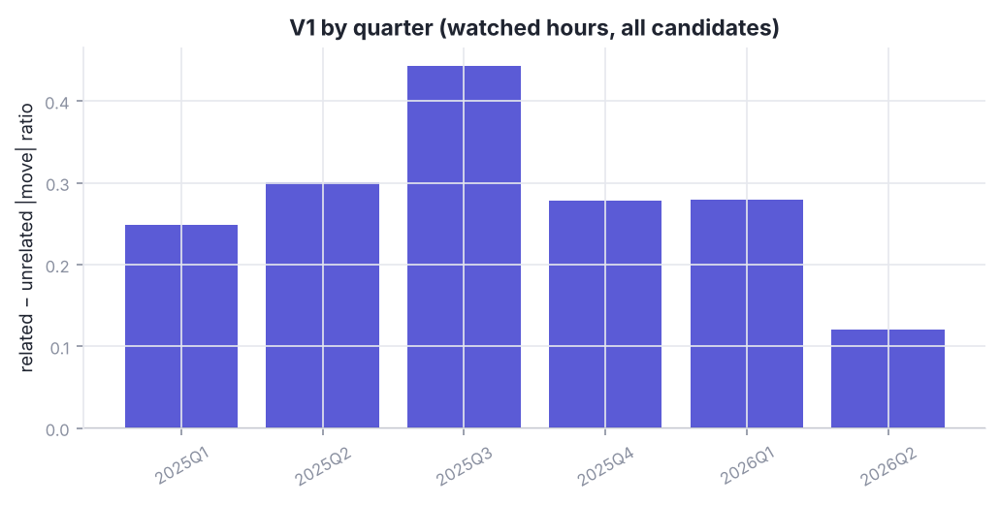
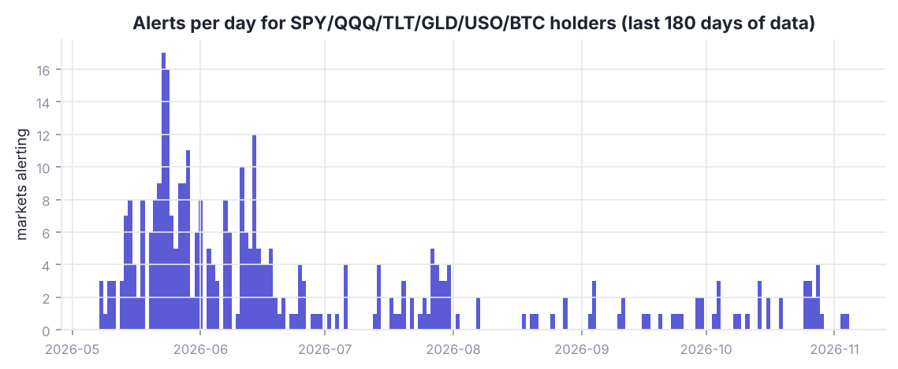

# T2-D · Daily-use applicability (docs/05)

Run `20261127-0236_daily_events_fix1` on dataset **events**.

| Experiment | Verdict | Headline |
|---|---|---|
| [D1 Point-in-time universe](d1/summary.md) | **pass** | Without the hindsight filter (329 markets, watch rule): V1 +0.24× (CI +0.14 to +0.33); W3 AUC gain +0.048 (CI +0.036 to +0.063); W5 whale +0.82 (CI low +0.64) vs retail +0.09 points. |
| [D2 Stability over time](d2/summary.md) | **pass** | V1 positive in 6 of 6 quarters (latest 2026Q2: +0.12×); W3 rolling gain positive in 8 of 8 quarters, pooled +0.049 (CI +0.040 to +0.060); W5 whale beats retail in 8 of 8 quarters. |
| [D3 Alert value and load](d3/summary.md) | **pass** | An alert is followed by a big move (top 20% of the asset's hours) 25% of the time for related assets vs 18% for unrelated ones (difference +7.5 points, CI +4.6 to +10.3). Reference portfolio: at least one alert on 55% of days, median 1/day, 95th percentile 8/day. |
| [D4 Live feasibility](d4/summary.md) | **pass** | 20261127-021157_live_check: refresh 21.1 s for 50 watched markets; median latest-trade age 19.1 min; BTC bar age -1.1 min; sources {'gamma': True, 'data_api': True, 'clob': True, 'yahoo': True}. |
| [D5 Daily resolution](d5/summary.md) | **pass** | Day level: on days a related market moves ≥ 10 points, related assets' daily move exceeds unrelated by +0.23× (CI +0.16 to +0.30, 397 markets); without crypto-price markets +0.11× (CI +0.04 to +0.17). |
| [D6 Generality across event types](d6/summary.md) | **pass** | Positive in 6 of 7 event groups (ai_tech +0.13, crypto +0.35, energy_mideast +0.17, rates +0.48, trade_china +0.52, us_politics -0.12, war_europe +0.20); leaving out any one group, the smallest lower CI is +0.10. |

**Decision (pre-registered rule):** All required daily-use gates pass: build prototype v1 with a daily digest.

## D1 · Point-in-time universe

**Question.** Do the passed findings hold on every market the app could see at the time, not only hindsight-chosen ones?

**Verdict: PASS.** Without the hindsight filter (329 markets, watch rule): V1 +0.24× (CI +0.14 to +0.33); W3 AUC gain +0.048 (CI +0.036 to +0.063); W5 whale +0.82 (CI low +0.64) vs retail +0.09 points.

| metric | value |
|---|---|
| checks.a_v1_all_candidates | True |
| checks.b_w3_gain | True |
| checks.c_w5_whale_above_retail | True |
| v1.mean | 0.2391 |
| v1.low | 0.1437 |
| v1.high | 0.3328 |
| v1.n | 329 |
| v1.groups | 329 |
| v1.p_two_sided | 0 |
| v1_slices | [{'slice': 'all candidates (watched)', 'mean': 0.2390950340556899, 'low': 0.14368858272352372, 'high': 0.3327802452462573, 'n': 329, 'groups': 329, 'p_two_sided': 0.0}, {'slice': 'research markets only', 'mean': 0.24192438849154954, 'low': 0.14624704245980003, 'high': 0.338747863575333, 'n': 321, 'groups': 321, 'p_two_sided': 0.0}, {'slice': 'markets the hindsight filter dropped', 'mean': 0.12556718731682265, 'low': -0.15828152830487818, 'high': 0.395288933226896, 'n': 8, 'groups': 8, 'p_two_sided': 0.38}, {'slice': 'lowest-volume third', 'mean': 0.2545808697157563, 'low': 0.11863962075467677, 'high': 0.40666095246092715, 'n': 107, 'groups': 107, 'p_two_sided': 0.001}] |
| w3.auc_price_only | 0.8695 |
| w3.auc_with_wallets | 0.9177 |
| w3.gain | 0.04825 |
| w3.low | 0.03564 |
| w3.high | 0.06255 |
| w3.top5pct_lift | 13.2 |
| w3.coefficients.intercept | -6.761 |
| w3.coefficients.abs_dp | 0.1402 |
| w3.coefficients.recent_vol | 0.4179 |
| w3.coefficients.gross_z | -0.0186 |
| w3.coefficients.whale_z | -0.0546 |
| w3.coefficients.wallets_z | 0.8308 |
| w3.coefficients.new_z | 0.0037 |
| w3.coefficients.imbalance | -0.0782 |
| w3.train_hours | 457813 |
| w3.test_hours | 371132 |
| w3.test_jumps | 1361 |
| w5_whale.mean | 0.008199 |
| w5_whale.low | 0.006404 |
| w5_whale.high | 0.009993 |
| w5_whale.n | 13223 |
| w5_whale.groups | 280 |
| w5_whale.p_two_sided | 0 |
| w5_retail.mean | 0.0009442 |
| w5_retail.low | 0.0004917 |
| w5_retail.high | 0.001443 |
| w5_retail.n | 44518 |
| w5_retail.groups | 322 |
| w5_retail.p_two_sided | 0.0005 |
| watched_wallet_hours | 837213 |
| low_volume_cut_usd | 3.151e+06 |

Tables: [v1_slices](d1/tables/v1_slices.csv)

- Watch rule: >= 24 h of history and probability 1 h earlier in 10-90%.
- Pass rule (pre-registered): (a) V1 CI > 0 on all candidates, (b) W3 gain CI > 0, (c) W5 whale CI above retail.

## D2 · Stability over time

**Question.** Do the effects keep holding quarter by quarter, including the most recent quarter?

**Verdict: PASS.** V1 positive in 6 of 6 quarters (latest 2026Q2: +0.12×); W3 rolling gain positive in 8 of 8 quarters, pooled +0.049 (CI +0.040 to +0.060); W5 whale beats retail in 8 of 8 quarters.

| metric | value |
|---|---|
| checks.a_v1_quarters | True |
| checks.b_w3_rolling | True |
| checks.c_w5_quarters | True |
| w3_pooled.gain | 0.0491 |
| w3_pooled.low | 0.03952 |
| w3_pooled.high | 0.06049 |
| v1_quarters | [{'quarter': '2024Q4', 'mean': 0.19256177836438687, 'markets': 5}, {'quarter': '2025Q1', 'mean': 0.2481072589931058, 'markets': 48}, {'quarter': '2025Q2', 'mean': 0.3007339154224479, 'markets': 48}, {'quarter': '2025Q3', 'mean': 0.44344318899521823, 'markets': 50}, {'quarter': '2025Q4', 'mean': 0.2777576898462823, 'markets': 61}, {'quarter': '2026Q1', 'mean': 0.27926005320069863, 'markets': 56}, {'quarter': '2026Q2', 'mean': 0.12104604032417332, 'markets': 75}, {'quarter': '2026Q3', 'mean': 0.3865217852953731, 'markets': 14}, {'quarter': '2026Q4', 'mean': -0.10661195115561499, 'markets': 4}] |
| w3_quarters | [{'quarter': '2025Q1', 'auc_price_only': 0.8819754742821888, 'auc_with_wallets': 0.9428675652120588, 'gain': 0.060892090929870024, 'test_hours': 87105, 'jumps': 310}, {'quarter': '2025Q2', 'auc_price_only': 0.8861676444644648, 'auc_with_wallets': 0.9316642259174079, 'gain': 0.04549658145294311, 'test_hours': 95553, 'jumps': 367}, {'quarter': '2025Q3', 'auc_price_only': 0.8906960337068861, 'auc_with_wallets': 0.9548007085978981, 'gain': 0.06410467489101201, 'test_hours': 161979, 'jumps': 264}, {'quarter': '2025Q4', 'auc_price_only': 0.8608237155076455, 'auc_with_wallets': 0.9048800538337858, 'gain': 0.04405633832614031, 'test_hours': 137002, 'jumps': 450}, {'quarter': '2026Q1', 'auc_price_only': 0.8917394310258824, 'auc_with_wallets': 0.935598336119857, 'gain': 0.04385890509397461, 'test_hours': 151531, 'jumps': 430}, {'quarter': '2026Q2', 'auc_price_only': 0.853815218370636, 'auc_with_wallets': 0.8970889805312193, 'gain': 0.04327376216058332, 'test_hours': 118571, 'jumps': 758}, {'quarter': '2026Q3', 'auc_price_only': 0.844941607030467, 'auc_with_wallets': 0.954136460057344, 'gain': 0.10919485302687704, 'test_hours': 42969, 'jumps': 70}, {'quarter': '2026Q4', 'auc_price_only': 0.8534585662043745, 'auc_with_wallets': 0.9347788587594011, 'gain': 0.0813202925550266, 'test_hours': 9692, 'jumps': 30}] |
| w5_quarters | [{'quarter': '2024Q3', 'whale': 0.004500000000000004, 'whale_markets': 1, 'retail': -0.006111111111111117, 'retail_markets': 1, 'diff': 0.01061111111111112}, {'quarter': '2024Q4', 'whale': 0.009213483146067415, 'whale_markets': 22, 'retail': -0.0013490566037735845, 'retail_markets': 34, 'diff': 0.010562539749841}, {'quarter': '2025Q1', 'whale': 0.010533538025507794, 'whale_markets': 91, 'retail': 0.001488705768298594, 'retail_markets': 107, 'diff': 0.009044832257209201}, {'quarter': '2025Q2', 'whale': 0.00853125, 'whale_markets': 97, 'retail': 0.002164061581854507, 'retail_markets': 112, 'diff': 0.006367188418145493}, {'quarter': '2025Q3', 'whale': 0.009994615384615385, 'whale_markets': 100, 'retail': 0.0032775271242883233, 'retail_markets': 137, 'diff': 0.0067170882603270615}, {'quarter': '2025Q4', 'whale': 0.008904377880184331, 'whale_markets': 120, 'retail': 0.0018050283860502835, 'retail_markets': 158, 'diff': 0.0070993494941340475}, {'quarter': '2026Q1', 'whale': 0.007623360655737705, 'whale_markets': 143, 'retail': 0.0013839015363911631, 'retail_markets': 183, 'diff': 0.0062394591193465415}, {'quarter': '2026Q2', 'whale': 0.009922535211267606, 'whale_markets': 151, 'retail': 0.0009841006533278887, 'retail_markets': 177, 'diff': 0.008938434557939717}, {'quarter': '2026Q3', 'whale': 0.0071718905472636825, 'whale_markets': 40, 'retail': 5.3943097193049665e-05, 'retail_markets': 44, 'diff': 0.007117947450070633}, {'quarter': '2026Q4', 'whale': 0.002364321608040201, 'whale_markets': 17, 'retail': -0.0011254002134471713, 'retail_markets': 20, 'diff': 0.0034897218214873724}] |

Tables: [v1_quarters](d2/tables/v1_quarters.csv), [w3_quarters](d2/tables/w3_quarters.csv), [w5_quarters](d2/tables/w5_quarters.csv)

- W3 is rolling-origin: each quarter is scored by a model trained only on hours before it.
- Pass rule (pre-registered): V1 > 0 in >= 2/3 of quarters with >= 20 markets and in the latest; W3 gain > 0 in >= 2/3 of quarters and pooled CI > 0; W5 whale > retail in >= 2/3 of quarters.

## D3 · Alert value and load

**Question.** Does an alert carry information, and would a daily user get a usable number of them?

**Verdict: PASS.** An alert is followed by a big move (top 20% of the asset's hours) 25% of the time for related assets vs 18% for unrelated ones (difference +7.5 points, CI +4.6 to +10.3). Reference portfolio: at least one alert on 55% of days, median 1/day, 95th percentile 8/day.

| metric | value |
|---|---|
| checks.a_alert_value | True |
| checks.b_load_some_days | True |
| checks.b_load_not_spam | True |
| value.mean | 0.07489 |
| value.low | 0.04573 |
| value.high | 0.1026 |
| value.n | 329 |
| value.groups | 329 |
| value.p_two_sided | 0 |
| mapped_big_rate | 0.2524 |
| placebo_big_rate | 0.1775 |
| share_days_with_alert | 0.547 |
| median_per_day | 1 |
| p95_per_day | 8 |
| mean_watched_markets_per_day | 28.85 |
| window | ['2026-05-08', '2026-11-04'] |

Tables: [alerts_per_day](d3/tables/alerts_per_day.csv)

- Counts are a lower bound: only a sample of markets was collected (limitation L5).
- Pass rule (pre-registered): big-move rate mapped − placebo CI > 0; >= 1 alert on >= 50% of days; 95th percentile <= 30 alerts/day.

## D4 · Live feasibility

**Question.** Can the app get the live data it needs, fresh and fast enough?

**Verdict: PASS.** 20261127-021157_live_check: refresh 21.1 s for 50 watched markets; median latest-trade age 19.1 min; BTC bar age -1.1 min; sources {'gamma': True, 'data_api': True, 'clob': True, 'yahoo': True}.

| metric | value |
|---|---|
| id | d4 |
| verdict | pass |
| run_at | 2026-11-26T18:12:18.116135+00:00 |
| reachable.gamma | True |
| reachable.data_api | True |
| reachable.clob | True |
| reachable.yahoo | True |
| checks.all_sources_reachable | True |
| checks.median_trade_age_ok | True |
| checks.btc_bar_fresh | True |
| checks.refresh_fast | True |
| refresh_seconds | 21.1 |
| markets_scanned | 500 |
| watched_markets | 50 |
| median_trade_age_min | 19.12 |
| markets_with_trade_last_hour | 45 |
| btc_bar_age_min | -1.143 |

- Pass rule (pre-registered): all sources reachable; median trade age <= 60 min; BTC bar <= 90 min; refresh <= 120 s.

## D5 · Daily resolution

**Question.** Is a once-a-day summary still informative?

**Verdict: PASS.** Day level: on days a related market moves ≥ 10 points, related assets' daily move exceeds unrelated by +0.23× (CI +0.16 to +0.30, 397 markets); without crypto-price markets +0.11× (CI +0.04 to +0.17).

| metric | value |
|---|---|
| main.mean | 0.2268 |
| main.low | 0.1575 |
| main.high | 0.2981 |
| main.n | 397 |
| main.groups | 397 |
| main.p_two_sided | 0 |
| without_crypto_price_markets.mean | 0.1059 |
| without_crypto_price_markets.low | 0.0434 |
| without_crypto_price_markets.high | 0.1689 |
| without_crypto_price_markets.n | 329 |
| without_crypto_price_markets.groups | 329 |
| without_crypto_price_markets.p_two_sided | 0.0005 |

- Probability sampled at each asset's daily close (16:00 ET stocks, 00:00 UTC crypto).
- Pass rule: CI > 0. Not required to build; decides the daily digest.

## D6 · Generality across event types

**Question.** Does the effect hold across event types, not only one group?

**Verdict: PASS.** Positive in 6 of 7 event groups (ai_tech +0.13, crypto +0.35, energy_mideast +0.17, rates +0.48, trade_china +0.52, us_politics -0.12, war_europe +0.20); leaving out any one group, the smallest lower CI is +0.10.

| metric | value |
|---|---|
| checks.half_of_groups_positive | True |
| checks.no_group_drives_it | True |
| by_group | [{'group': 'ai_tech', 'mean': 0.12698727315954486, 'low': -0.02296730567848072, 'high': 0.26384299172250036, 'n': 40, 'groups': 40, 'p_two_sided': 0.0855}, {'group': 'crypto', 'mean': 0.35221994298785897, 'low': 0.14908745788336114, 'high': 0.547560793346046, 'n': 65, 'groups': 65, 'p_two_sided': 0.0}, {'group': 'energy_mideast', 'mean': 0.17450283070728717, 'low': 0.017945116916322376, 'high': 0.3445692120284679, 'n': 85, 'groups': 85, 'p_two_sided': 0.034}, {'group': 'rates', 'mean': 0.48283988521893934, 'low': -0.03471704891048922, 'high': 1.0029259216427013, 'n': 33, 'groups': 33, 'p_two_sided': 0.071}, {'group': 'trade_china', 'mean': 0.518753890988436, 'low': 0.11566621410389064, 'high': 1.024731952998463, 'n': 27, 'groups': 27, 'p_two_sided': 0.027}, {'group': 'us_politics', 'mean': -0.12158842836750769, 'low': -0.30451604680145633, 'high': 0.045385135006955644, 'n': 38, 'groups': 38, 'p_two_sided': 0.182}, {'group': 'war_europe', 'mean': 0.20347736706978886, 'low': 0.07852520971045836, 'high': 0.34778744721232824, 'n': 37, 'groups': 37, 'p_two_sided': 0.005}] |
| leave_one_out | [{'left_out': 'ai_tech', 'mean': 0.2546116791624228, 'low': 0.15425042132561562, 'high': 0.36189051506087805, 'n': 289, 'groups': 289, 'p_two_sided': 0.0}, {'left_out': 'crypto', 'mean': 0.21124231026557252, 'low': 0.10450583938136725, 'high': 0.31740338640679105, 'n': 264, 'groups': 264, 'p_two_sided': 0.0}, {'left_out': 'energy_mideast', 'mean': 0.2615964163696826, 'low': 0.14743244407437353, 'high': 0.37449517226515433, 'n': 244, 'groups': 244, 'p_two_sided': 0.0}, {'left_out': 'rates', 'mean': 0.21192077700032763, 'low': 0.12411372194870658, 'high': 0.30475817658092774, 'n': 296, 'groups': 296, 'p_two_sided': 0.0}, {'left_out': 'trade_china', 'mean': 0.21409242101865633, 'low': 0.1172689139350642, 'high': 0.31344471811124625, 'n': 302, 'groups': 302, 'p_two_sided': 0.0}, {'left_out': 'us_politics', 'mean': 0.28619459272263664, 'low': 0.18581329739566707, 'high': 0.3912916125191481, 'n': 291, 'groups': 291, 'p_two_sided': 0.0}, {'left_out': 'war_europe', 'mean': 0.24360823158472533, 'low': 0.13952856538450728, 'high': 0.34634476161139505, 'n': 292, 'groups': 292, 'p_two_sided': 0.0}] |

Tables: [by_group](d6/tables/by_group.csv), [leave_one_out](d6/tables/leave_one_out.csv)

- Pass rule (pre-registered): > 0 in >= half of groups with >= 10 markets; every leave-one-group-out CI > 0.
